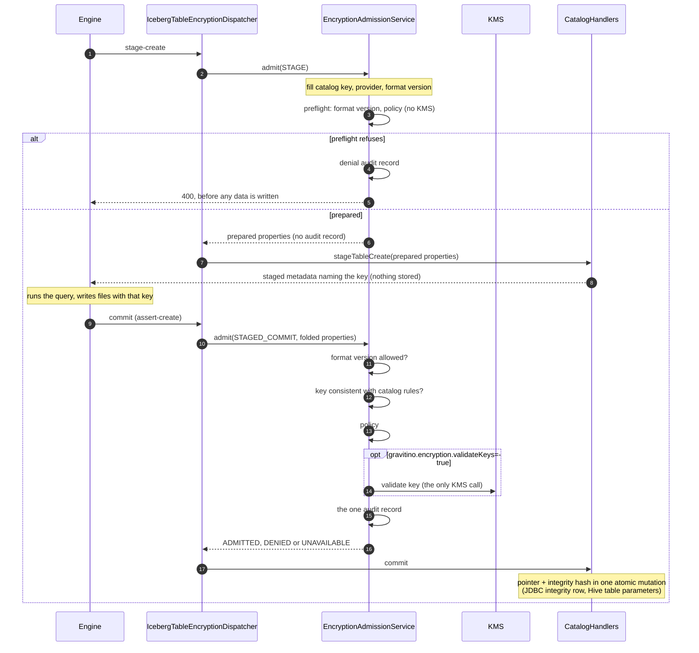
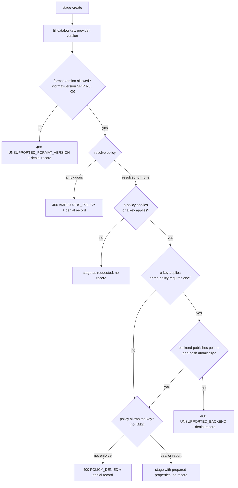
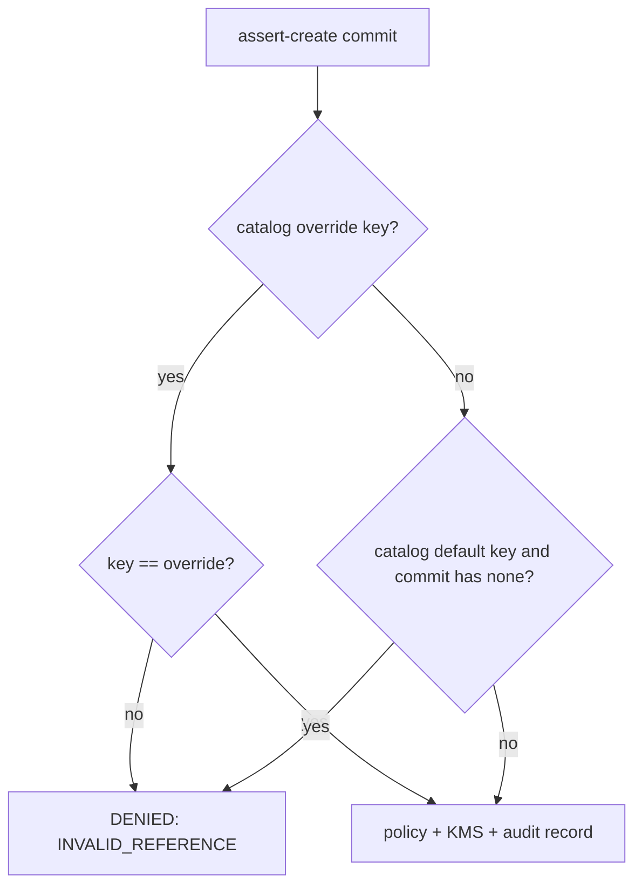

<!--
  Copyright 2026 Datastrato Inc.
-->
# Design: admitting staged creates (CTAS) on the Iceberg REST catalog

Scope: the Iceberg REST catalog (IRC) API only. Stage-create is a REST protocol concept. The
Gravitino table API has no staged create, and native Hive clients never reach this path.

Roles are unchanged from the SPIP. The catalog decides and records the key reference. The engine
encrypts with it.

**Revised after review (2026-09-18).** A stage stores nothing, so it no longer makes a full
admission. Stage prepares the table: it fills in the key and refuses early what the commit would
refuse anyway. Commit is the one authoritative decision: policy, the KMS check when
`gravitino.encryption.validateKeys=true`, and a single audit record.

## 1. Problem

Engines run `CREATE TABLE AS SELECT` on the IRC in three steps:

1. **Stage.** `POST .../tables` with `stage-create: true`. The server returns table metadata and
   stores nothing.
2. **Write.** The engine runs the query and writes data files using the key named in that metadata.
3. **Commit.** `POST .../tables/{table}` with `assert-create`. The table exists only after this.

Iceberg's `CatalogHandlers.stageTableCreate` builds the staged metadata from `created-at` plus the
request properties only (iceberg-core 1.11.0, `CatalogHandlers.java:415-440`). If stage passes the
request through, the catalog's key never reaches the engine, and the commit is refused. CTAS then
fails on every catalog that binds a key. So stage must fill in the key. The question this design
answers is what else stage does, and what is left for commit.

## 2. Rule

**Stage prepares; commit decides.**

| Step | Does | Does not |
| --- | --- | --- |
| **Stage** (`Operation.STAGE`) | Fills in the catalog key, provider and resolved format version with the same merge as a create. Preflight, all without KMS: the backend can publish atomically, the format-version rule, the policy check. | Call the KMS. Write an audit record on success. Store anything, including an integrity hash. |
| **Commit** (`Operation.STAGED_COMMIT`) | Checks the key against the catalog rules, evaluates the policy, validates the key with the KMS once when `validateKeys=true`, writes the one audit record, publishes the metadata pointer and its integrity hash in one atomic backend mutation. | Inherit a key: files are already written under the key stage named. |

- **Stage is not authoritative.** Its preflight only refuses early what commit would refuse anyway,
  so a disallowed key fails before the query runs rather than after it has written data.
- **A refused stage writes a denial record.** It is the only record of that attempt. A successful
  stage writes nothing: nothing was created.
- **Commit is admitted in full** because the server keeps no state between stage and commit, a
  client can commit `assert-create` without staging, and the policy may change in between.
- Gravitino applies catalog key rules itself on every write path and never relies on Iceberg to
  apply `table-default.` or `table-override.` keys.

### Sequence

### Stage preflight

### Commit key check

Runs at commit right after the format-version rule, before policy and before any KMS call.

### Metadata integrity

A CTAS gets the same integrity guarantee as any create; nothing about it is staged.

- **Stage writes no metadata and no hash.** The staged metadata exists only in the response.
- **Commit publishes the pointer and its integrity hash in one atomic backend mutation**, as the
  [ADR](design-trusted-metadata-integrity.md) requires: the integrity row beside `iceberg_tables` in
  one transaction on JDBC, the table parameters of one alter on Hive. The hash covers the committed
  `metadata.json`, which already contains the engine's first snapshot.
- **Loads verify from then on.** A later commit advances the hash; a mismatch on load is refused as
  an integrity failure.
- **A backend that cannot publish atomically** (no integrity store, or an unsupported product) is
  refused at stage, before the query runs, with `UNSUPPORTED_BACKEND`. Commit checks it again.
- **Integrity store unavailable at commit** (for example the JDBC integrity table is missing):
  the commit fails closed and publishes nothing; the written files are orphaned, as for any failed
  commit.
- **Federated catalogs** are pass-through: stage and commit are forwarded untouched and no hash is
  written ([design](metadata-integrity/design-federated-catalogs.md)).

### The catalog's own format version

Prepared properties are not enough for the publishing commit. Iceberg's create-commit handler
builds its placeholder table from the **catalog's** properties at the catalog's default format
version, before any Enterprise code runs: on a catalog that binds a key with a version-2 default,
that placeholder carries the key at version 2 and `EncryptionUtil.checkCompatibility` throws
`Invalid properties for v2: [encryption.key-id]`. The engine has written its data files by then, so
the CTAS fails late. The fix is a catalog property Gravitino reads but does not write: the operator who binds a key also
declares version 3 on the catalog: `table-default.format-version=3`, or a `table-override.format-version`
of 3 or more, which R9 reads first. Where it is unset, stage refuses the CTAS before the engine
writes — with no version because the effective version is 2, and with an explicit
`format-version=3` because the placeholder above is built from the catalog's properties, not the
request's — and for the same reason when the client names a key of its own. That is R3, R5 and R9 of
[SPIP: Encryption and Iceberg format version](metadata-integrity/SPIP-encryption-format-version.md);
appendix A.5 there carries the mechanism.

## 3. Code changes

| Where | Change |
| --- | --- |
| `EncryptionAdmissionService.Operation` | New `STAGE`: prepare and preflight. `CREATE` no longer covers the stage step. `STAGED_COMMIT` javadoc: the key is present because stage filled it in; the commit is the authoritative admission. |
| `EncryptionAdmissionService.admit` | For `STAGE`: the same key merge and format-version rule as `CREATE`, then the policy check without the KMS step. Success returns prepared properties and no audit extras; a refusal returns the failure and a denial audit record. |
| `IcebergEncryptionPolicyEvaluator` | A preflight evaluation that stops before the KMS call (`KmsValidationStatus.NOT_ATTEMPTED`) and never refuses under `report`. |
| `IcebergTableEncryptionDispatcher.createTable` | A stage-create request is admitted as `STAGE`; its prepared properties go into the stage request, which keeps the stage flag. |
| `IcebergTableEncryptionDispatcher.updateTable` | The `assert-create` commit is admitted as `STAGED_COMMIT` on the encryption properties its `SetProperties` and `RemoveProperties` updates fold to, plus the version its `UpgradeFormatVersion` names. On success it appends the admitted key binding as a `SetProperties` update and, when the commit names no format version, an `UpgradeFormatVersion` to the version admission resolved. |
| Backend publication (`IntegrityJdbcTableOperations`, Hive) | None: the commit already publishes pointer and hash atomically; this design only moves the capability check earlier. |
| `EncryptionPropertyRules` | None: key lookup, inheritance, provider completion and the staged-commit key check are shared by `STAGE` and `CREATE`. |

No new outcome, failure kind, or server state.

## 4. Tests

Unit (core) and rest-server tests. Keyed catalogs declare `table-default.format-version=3` unless a
test says otherwise; without it every keyed create is refused on version (R3):

1. **Stage fills in the key.** Override key, no client key: the response names the override key and
   provider at version 3; no KMS call.
2. **Stage keeps a client key.** Default key plus a client key: the client key is kept; no KMS call.
3. **Stage refuses on policy early.** Enforce policy, key not on the allow list: 400 at stage, one
   denial record, no KMS call, the backend is not called.
4. **Stage refuses on version early.** Key with explicit `format-version=2`, or key with no version
   on a catalog declaring none: 400 `UNSUPPORTED_FORMAT_VERSION` at stage, one denial record, no KMS
   call.
5. **Stage under report.** Report policy, key not on the list: staged; no record at stage.
6. **Round trip, one decision.** Stage, then commit built through Iceberg's `RESTSessionCatalog` or
   `RESTTableOperations` (not by hand): the table names the key; exactly one KMS call (with
   `validateKeys=true`; none by default) and one audit record, both at commit; the report violation
   of test 5 is recorded once, at commit.
7. **Commit without stage.** `assert-create` with no stage and no key on a keyed catalog: DENIED,
   no KMS call.
8. **Commit with a different key** than stage returned, on an override catalog: DENIED
   `INVALID_REFERENCE`, no KMS call.
9. **KMS rejects at commit** (with `validateKeys=true`). The key passes stage; the KMS rejects it at
   commit: 400 at commit, one audit record; the table does not exist.
10. **Policy changes between stage and commit.** The key is allowed at stage and removed from the
    allow list before commit: DENIED at commit.
11. **Unkeyed catalog, no policy.** Stage and commit are forwarded unchanged; no KMS call, no record.
12. **Unsupported backend refused at stage.** Encrypted stage on a backend without atomic integrity:
    400 `UNSUPPORTED_BACKEND` at stage, no KMS call, the backend is not called.
13. **CTAS publishes a verified table.** After the round trip of test 6 the table's integrity hash is
    present and matches the committed `metadata.json`, and a load verifies.
14. **Integrity store unavailable at commit.** Nothing is published and the table does not exist.
15. **Federated CTAS.** Stage and commit are forwarded untouched; no admission, no hash.

Integration (PostgreSQL, MySQL, Hive): tests 6, 9, 13 and the CTAS journey through the real server,
including a tampered `metadata.json` after a CTAS being refused on load.
Later, outside the current ITs: an engine CTAS end to end, checking that the written files are
encrypted with the admitted key (Appendix A.3).

## 5. Critical user journeys

Keyed catalogs declare `table-default.format-version=3`; on one that does not, every journey below
that stages a key without naming a version is refused at stage instead (R3, R5).

KMS and audit counts are per CTAS. "Late" means after the query has written its files. KMS counts
and journeys 5 and 6 assume `gravitino.encryption.validateKeys=true`; by default a CTAS makes no
server KMS call, and a key the KMS rejects fails in the engine's KMS client during the write.

| # | Journey | Before this revision | This design |
| --- | --- | --- | --- |
| 1 | CTAS on a keyed catalog, allowed key | created; KMS 2, audit 2 | created; **KMS 1, audit 1** |
| 2 | Enforce policy, key not on the allow list | 400 at stage; audit 1 | 400 at stage; 1 denial record |
| 3 | Report policy, key not on the list | created; 2 violation records | created; **1 violation record** |
| 4 | Key plus explicit `format-version=2` | refused at stage | 400 `UNSUPPORTED_FORMAT_VERSION` at stage |
| 5 | KMS rejects the key (disabled) | 400 at stage | 400 at commit, late |
| 6 | KMS unreachable | 503 at stage | 503 at commit, late; the commit can be retried |
| 7 | Engine aborts after stage | an "admitted" record for a table that never exists | nothing recorded |
| 8 | `assert-create` with no stage and no key | DENIED at commit, no KMS | same |
| 9 | Commit carries a different key than stage returned | DENIED `INVALID_REFERENCE` | same |
| 10 | Policy changes between stage and commit | DENIED at commit, late | same: commit decides |
| 11 | Unkeyed catalog, no policy | forwarded, no KMS, no record | same |
| 12 | Encrypted CTAS on a backend without atomic integrity | 400 `UNSUPPORTED_BACKEND` at stage | same, via the preflight, no KMS |
| 13 | Load right after a CTAS | verified against the hash the commit wrote | same |
| 14 | `metadata.json` tampered after a CTAS, then loaded | refused as an integrity failure | same |
| 15 | Integrity store unavailable at commit | commit fails closed, files orphaned | same |
| 16 | CTAS on a federated catalog | refused if encrypted (before #2121) | forwarded untouched, no hash |

## 6. Decisions

- **Stage prepares; commit decides.** One audit record per CTAS, at commit. With
  `gravitino.encryption.validateKeys=true`, commit also makes the one KMS validation; by default it
  decides and records the result without server-side KMS inspection.
- **Preflight at stage** keeps the early refusal for policy and format version, so a disallowed key
  does not cost a full query. It calls no KMS and records only refusals.
- **Accepted trade-off (with `validateKeys=true`):** a key the KMS rejects, or an unreachable KMS,
  is refused only at commit, after the files are written (journeys 5, 6). In practice the engine
  needs the same KMS to encrypt, so it usually fails during the write first.
- **An abandoned CTAS leaves no record** (journey 7): nothing was created.
- Out of scope: `REPLACE TABLE` and `REPLACE TABLE AS SELECT` on an existing table. They are not
  staged creates and this design does not cover them.

## Appendix A. Spark CTAS on the IRC, from source

Source: Apache Iceberg `apache-iceberg-1.11.0` (core, spark 3.5; spark 4.0 is identical here).

**A.1 Spark stages.** `SparkCatalog.stageCreate` -> `buildTable(...).createTransaction()`
(`SparkCatalog.java:265-281`). Commit is `transaction.commitTransaction()`. Abort does nothing
(`StagedSparkTable.java:33-40`). RTAS uses `replaceTransaction()` (`:295`).

**A.2 The REST client sends the stage and builds on the reply.**
`RESTSessionCatalog.createTransaction` sends `stage-create` (`:1119`). It merges its own
`table-default.*` and `table-override.*` into the request properties (`:891`, `:1114`). The server's
catalog-level prefixes are not sent through `/v1/config`. The transaction's base is the metadata the
server returns (`:1012`, `:1023`). Iceberg itself rejects a client-supplied key below format version
3 at stage (`TableMetadata.java:144`). A catalog-bound key is not in the request properties
(section 1), so that check never sees it — except in the location placeholder a request without a
`location` triggers (`CatalogHandlers.java:419-431`), which is built through the backend catalog and
so does carry the catalog's `table-default.*` and `table-override.*`.

**A.3 The engine encrypts.** Spark writers encrypt through the table's `encryption()`
(`OutputFileFactory.java:108,120,180`; manifests `SnapshotProducer.java:607`). Note for the later
test: in 1.11.0, `RESTTableOperations` does not override `encryption()`, so it falls back to the
plaintext manager. Only `HiveTableOperations` wires a KMS client. Engine-side encryption over REST
therefore depends on the client build, which the SPIP puts out of scope.

**A.4 The commit.** `RESTTableOperations.commit` sends the staged metadata's changes (`AssignUUID`,
`UpgradeFormatVersion`, `SetProperties` including the key id and provider) plus the write's
snapshot updates, under `AssertTableDoesNotExist` (`RESTSessionCatalog.java:1140-1176`,
`UpdateRequirements.java:32-38`). Iceberg rejects no extra property such as
`encryption.key-provider`. The section 2 check reads this commit.
