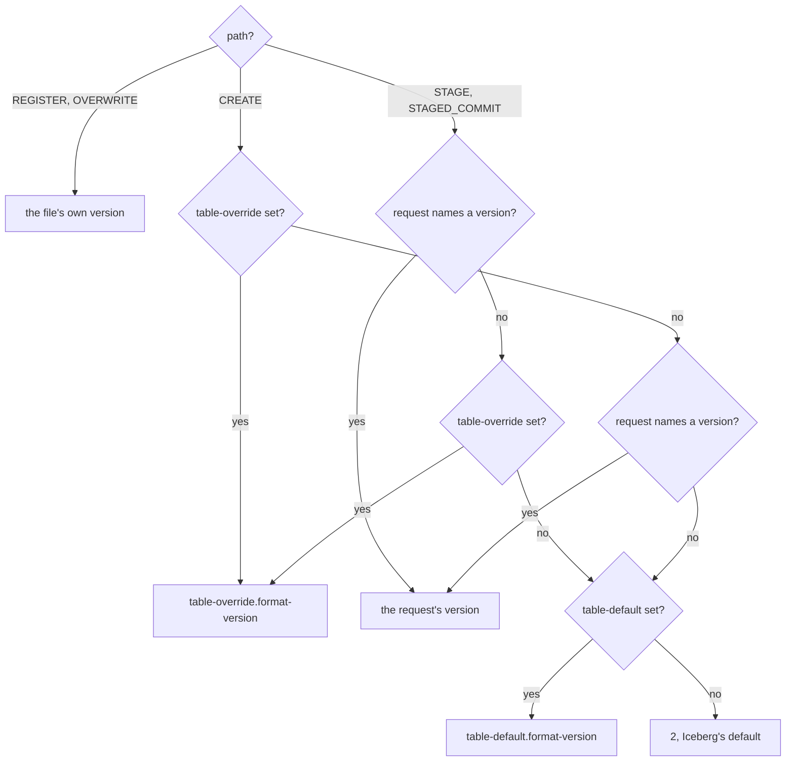
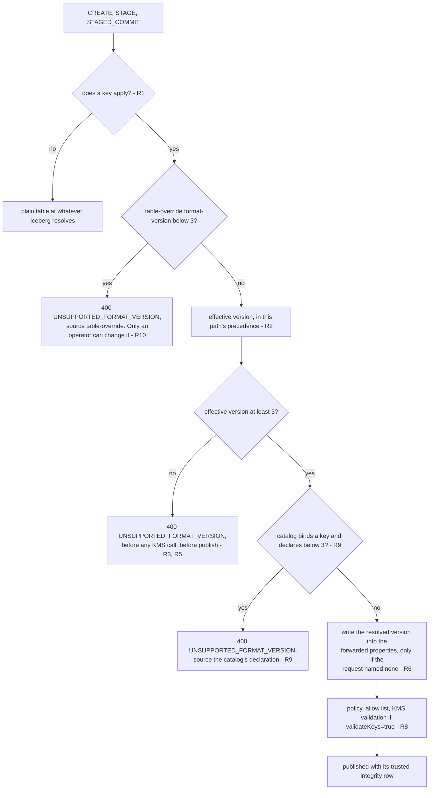
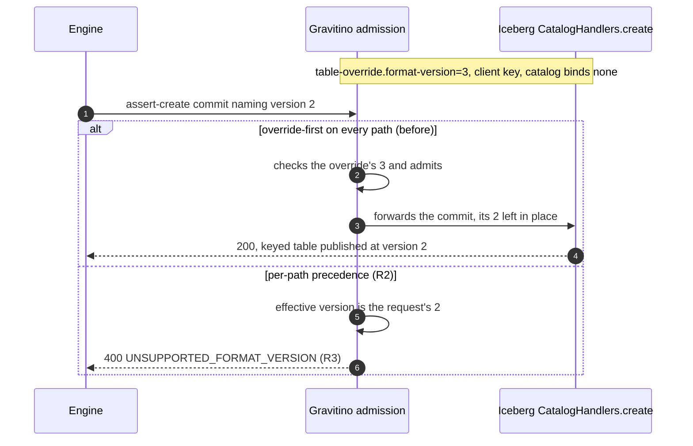

<!--
  Copyright 2026 Datastrato Inc.
-->

# SPIP: Encryption and Iceberg format version

| Field             | Value                                                                                                                                                                                             |
| ----------------- | ------------------------------------------------------------------------------------------------------------------------------------------------------------------------------------------------- |
| Status            | Proposed — revised 2026-09-22 after review: no new catalog properties, refuse below version 3 instead of normalising to it; amended 2026-09-23 with per-path resolution and R10 (Appendix D)      |
| Author            | Nevin Zheng ([@nevzheng](https://github.com/nevzheng))                                                                                                                                            |
| Reviewers         | [@roryqi](https://github.com/roryqi), [@jerryshao](https://github.com/jerryshao), [@markhoerth](https://github.com/markhoerth)                                                                    |
| Created / updated | 2026-09-17 / 2026-09-23                                                                                                                                                                           |
| Parent            | [SPIP: Governed Iceberg Table Encryption](../SPIP-governed-iceberg-encryption.md)                                                                                                                 |
| Siblings          | [Hive](SPIP-hive-encryption-guarantees-and-policy-enforcement.md) · [JDBC](SPIP-jdbc-encryption-guarantees-and-atomic-integrity.md) · [one admission path](SPIP-one-encryption-admission-path.md) |

---

## Background

Iceberg table encryption requires format version 3. Gravitino must decide what happens when an
encrypted table would be created at a lower version.

**What Gravitino does today** (on `main`, under the #2097 promotion design). Three answers, none
stated in one place:

| Path                       | Current behaviour                                                                      | Where                                        |
| -------------------------- | -------------------------------------------------------------------------------------- | -------------------------------------------- |
| Gravitino API create       | Stamps `format-version=2` on every create, then admission raises an encrypted one to 3 | `IcebergTable.rebuildCreateProperties`       |
| Iceberg REST create        | Iceberg's own default (2), then admission raises an encrypted one to 3                 | `EncryptionPropertyRules.admittedProperties` |
| Iceberg REST staged commit | Appends an `UpgradeFormatVersion` update so the published table is at 3                | `IcebergTableEncryptionDispatcher`           |

**What is wrong with it.**

1. **A version the client did not ask for.** A client that explicitly requests `format-version=2`
   with a key silently gets a version 3 table.
2. **The Gravitino API masks the catalog's own default.** `rebuildCreateProperties` stamps `2`
   whenever the request omits a version, so an operator who sets Iceberg's
   `table-default.format-version` on a lakehouse-iceberg catalog sees it ignored.
3. **CTAS fails after the data is written.** On a catalog that binds a key but whose
   `table-default.format-version` is Iceberg's default of 2, `CatalogHandlers.updateTable` rebuilds
   the table from the **catalog's** properties, not the request's
   (`CatalogHandlers.java:552` → `BaseMetastoreCatalog:153,241,249` → `TableMetadata:144`,
   `EncryptionUtil.checkCompatibility`), and throws
   `Invalid properties for v2: [encryption.key-id]` at commit. Observed on PostgreSQL and MySQL.
4. **The rule was implicit**, set per path rather than specified once.

**Why now.** The first revision of this SPIP answered 1–4 with two Gravitino catalog properties
(`table-format-version.default`, `table-format-version.max`) and by normalising encrypted creates up
to version 3. Review rejected both halves: Iceberg already owns the default through
`table-default.format-version`, a catalog-wide maximum is a separate compatibility concern, and a
create must not be silently promoted. This revision re-specifies the feature accordingly.

---

## Goals

1. **One rule, stated once**: a new table to which an encryption key applies is created at format
   version 3 or above, or the request is refused. The rule lives in the encryption admission path,
   identical on the Gravitino API and the Iceberg REST catalog.
2. **No silent version changes**: Gravitino creates a table only at the version the request and the
   catalog's own Iceberg settings resolve to. A create that cannot satisfy the minimum is refused,
   never promoted.
3. **No new catalog vocabulary**: only Iceberg's existing `format-version`,
   `table-default.format-version` and `table-override.format-version` control the version. Gravitino
   adds no property of its own and removes the two it proposed earlier.
4. **Refusal before cost**: a version refusal is returned before any KMS call and, for staged creates
   and CTAS, before the table is published.
5. **No bypass through catalog overrides**: `table-override.format-version=2` on a keyed catalog
   refuses the create rather than being ignored, on every path Iceberg builds. A registered file is
   not governed by the override (R10).
6. **The operator's default actually applies**: `table-default.format-version` set on a catalog
   reaches table creation on both APIs once the `format-version=2` stamp in
   `IcebergTable.rebuildCreateProperties` is removed.
7. **Existing tables are untouched**: binding a key or changing a catalog default neither adds a key
   to an existing table nor upgrades its version.
8. **A catalog-bound key never fails late**: a create on a catalog that binds a key is decided before
   the engine writes, never at the publishing commit (R9).

---

## Non-Goals

1. **A Gravitino-owned default or maximum format version**: Iceberg's `table-default.format-version`
   and `table-override.format-version` already set the default and pin a version, and the bundled
   Iceberg refuses versions it cannot write. A catalog-wide maximum is a compatibility policy, not
   part of deciding whether an encrypted table can be created; a concrete use case would get its own
   proposal.
2. **Choosing a version on the caller's behalf**: an encrypted create below version 3 is refused. The
   caller requests version 3, or the operator sets `table-default.format-version=3`.
3. **Validating the catalog's configuration**: creating or altering a catalog is not refused for
   declaring a version below 3. R9 instead rejects the *create* in the admission path, closing the
   same failure without a new way to make an existing catalog unalterable. See
   [Option C](#option-c-reject-plus-a-catalog-level-gate).
4. **Compatibility for engines that cannot read version 3**: they cannot read encrypted tables at all;
   the answer is a separate unkeyed catalog, not a per-table flag.
5. **Upgrading or downgrading existing tables**: Iceberg forbids downgrades, and binding a key
   upgrades nothing (Goal 7).
6. **Encrypting files**: the engine does that. The catalog records and enforces the key reference
   (parent SPIP).

---

## Solution Investigations

| Approach                                                 | Pros                                                                           | Cons                                                                                                                 | Decision   |
| -------------------------------------------------------- | ------------------------------------------------------------------------------ | -------------------------------------------------------------------------------------------------------------------- | ---------- |
| A. Two Gravitino properties + normalise to v3            | CTAS works with no operator action; one place to set the default               | Duplicates `table-default.format-version`; silently overrides an explicit request; adds a maximum nobody asked for   | Rejected   |
| **B. Refuse below v3 on the effective version (chosen)** | No new vocabulary; a request is honoured or clearly refused; smallest diff     | A keyed catalog left at Iceberg's v2 default refuses every create until the operator sets one property               | **Chosen** |
| C. B plus a catalog-level gate                           | Turns the misconfiguration into a config-time error instead of a user-time one | R9 already closes the failure; gating also makes every existing keyed catalog unalterable until an operator edits it | Rejected   |
| D. B plus a startup warning                              | Cheap                                                                          | Same failure modes as B, with a log line as the only difference                                                      | Rejected   |

### Option A: Gravitino-owned properties with normalisation

`table-format-version.default` sets the default version on both APIs; `table-format-version.max` caps
every table; an encrypted create below 3 is raised to `max(3, default)`; a catalog that binds a key
derives `table-default.format-version` from those properties.

**Pros:** CTAS succeeds on a keyed catalog with no extra operator step, because Gravitino writes the
catalog's Iceberg default itself. One Gravitino-spelled property to document.

**Cons:** `table-format-version.default` duplicates `table-default.format-version`, which Iceberg
already resolves. The maximum is a catalog-wide compatibility policy unrelated to whether an
encrypted table can be created, and it required a new cross-property validation hook in core. Worst,
the normalisation silently creates a table at a version the caller did not request.

**Decision:** Rejected in review. This revision closes the four pull requests that implemented it.

### Option B: Refuse below version 3 on the effective version (Chosen)

Resolve the version the create would land at from Iceberg's own settings, and refuse when a key
applies and that version is below 3.

**Pros:** No new properties, no core validation hook, and a smaller change than Option A. A caller's
explicit version is always honoured or explicitly refused. Operators configure the version with the
Iceberg property they already use.

**Cons:** A catalog that binds a key but leaves `table-default.format-version` at Iceberg's default
refuses every create that does not name a version. The operator must set two properties together for
the catalog to be usable, and nothing tells them so until a user's create fails.

**Decision:** Chosen: it is what review asked for, and its cost is a documentation and messaging
problem, not a correctness one.

### Option C: Reject plus a catalog-level gate

Option B, plus: creating or altering a catalog that binds an encryption key is refused unless its
effective `table-default.format-version` is 3 or higher.

**Pros:** The misconfiguration R9 refuses at stage becomes impossible, so the operator learns of it
at configuration time, not through a user's failed create.

**Cons:** Review did not ask for it, and separately asked to reconsider the cross-property catalog
validation it depends on. As catalog-level validation, not table-level promotion, it does not
conflict with Goal 2, but it goes beyond the requested design.

**Decision:** Rejected. R9 closes the same failure inside the admission path, so the gate buys only
an earlier message, at the cost of an upgrade hazard: Gravitino writes
`table-default.format-version` on keyed catalogs today, so every catalog configured before this
change declares version 2 and would become unalterable until an operator edits it. Nothing here
forecloses adding it later as an operator convenience, additive to R9.

### Option D: Reject plus a startup warning

Option B, plus a warning logged when a catalog binds a key and its effective default version is below
3.

**Pros:** Cheap, and no new refusal path.

**Cons:** The same failure modes as Option B for every user of the catalog; the warning reaches only
whoever reads server logs, not the person whose create fails.

**Decision:** Rejected. It adds a signal without changing an outcome.

---

## Proposal

### R1. Trigger

The rule applies when **a key applies** to a new table: the catalog binds a `table-default.` or
`table-override.` encryption key, or the client supplies one. A policy never supplies a key; a policy
that requires encryption refuses a keyless create on its own grounds. A `report` policy with no key is
not a trigger.

### R2. The effective format version

The version the table will land at. Iceberg resolves it differently per path, and so does this rule.

| Path                     | What Iceberg applies               | Precedence                                                                                       |
| ------------------------ | ---------------------------------- | ------------------------------------------------------------------------------------------------ |
| `CREATE`                 | the catalog's default and override | `table-override.format-version`, then the request, then `table-default.format-version`, then `2` |
| `STAGE`, `STAGED_COMMIT` | the request's properties only      | the request, then `table-override.format-version`, then `table-default.format-version`, then `2` |
| `REGISTER`, `OVERWRITE`  | nothing; the file decides          | the metadata file's own version                                                                  |



On `CREATE`, `BaseMetastoreCatalogTableBuilder` seeds the table with `tableDefaultProperties()`
(`BaseMetastoreCatalog:153`), layers the request on top (`:175-180`), and applies
`tableOverrideProperties()` last (`:196`), so the override wins. On the staged paths
`CatalogHandlers.stageTableCreate` (`:406-443`) builds the staged metadata from the request's own
properties, and `CatalogHandlers.create` (`:598-611`) builds a stage-less `assert-create` commit
from `TableMetadata.buildFromEmpty` plus the commit's updates. Neither persists the catalog's
properties. An operator's declaration reaches a staged table only because Gravitino carries it there
(R6), so on those paths it ranks after the request.

Each catalog property is read under its plain and its `gravitino.bypass.` spelling, plain winning,
as the encryption key is. A blank or whitespace value counts as absent. For a staged commit the
"request's version" is the highest `upgrade-format-version` the commit carries; a commit carrying
none has an omitted version.

**One resolution, one answer.** The version checked and the version forwarded come from one call;
Appendix D gives the signature, and the case an override-first resolution gets wrong.

### R3. Below version 3 is refused

When a key applies and the effective version is below 3 — including an omitted version that resolves
to Iceberg's default of 2 — the request is refused with `UNSUPPORTED_FORMAT_VERSION`, before any KMS
call. Gravitino never raises the version to satisfy the rule.

Nothing here sets a ceiling; Iceberg's `SUPPORTED_TABLE_FORMAT_VERSION` (4 in the bundled 1.11.0) is
the only one.

It is satisfied by an explicit `format-version=3` in the request, or by a catalog that declares 3 or
above. Neither works when `table-override.format-version` pins the catalog below 3: only an operator
can resolve that, and the R10 refusal says so rather than offering a remedy that cannot work.

### R4. The override is part of the answer on `CREATE`

On `CREATE`, `table-override.format-version=2` makes the effective version 2 and the create is
refused, even when the request asks for 3. The override is Iceberg's contract and Gravitino does not
work around it.

On `STAGE` and `STAGED_COMMIT` Iceberg never applies the override to the persisted table; it lands
there only when the request names no version and Gravitino writes it (R2, R6). When the request
names a version the override is not the effective version, yet the create is still refused, as a
catalog mandate (R10).

On `REGISTER` and `OVERWRITE` the override has no bearing: Iceberg does not consult the catalog, and
the file's own version is the one checked.

An override **above** the request is the mirror case: on `CREATE` Iceberg replaces the client's 2
with the override's 3. The raise is Iceberg's, not Gravitino's; Appendix D row 4 squares it with
Goal 2.

### R5. Staged creates and CTAS

The same check runs at stage, before the table is published and before the engine writes. A
stage-create with no version on a catalog that does not declare 3 is refused at stage. An
unspecified-version CTAS never starts at version 3 automatically.

### R6. The resolved version is written, not raised

Where the request named no version, admission writes the version R2 resolved into the properties it
forwards: the override when set, else `table-default.format-version`, else 2, as `format-version` on
a create or stage, or as an appended `UpgradeFormatVersion` on a staged commit. This is not a raise.
It is required because Iceberg does not apply catalog defaults to staged metadata
(`CatalogHandlers.java:406`) or to a stage-less `assert-create` commit (`:605`); without it a keyed
table could be published at version 2.

### R7. Existing tables

Binding a key or changing a catalog default affects new tables only. An existing unencrypted version 1
or 2 table keeps its version, gains no key, and loads and commits as before. No commit adds or removes
a key. The rule is evaluated only where a table does not yet exist: `CREATE`, `STAGE`,
`STAGED_COMMIT`, `REGISTER`, `OVERWRITE` — never on load, an ordinary commit, `upgrade-format-version`,
or `REPLACE TABLE`.

This holds for the two Gravitino APIs. Iceberg's own `replaceTransaction` merges the catalog's
`table-default.*` and `table-override.*` into the replacement and never calls
`EncryptionUtil.checkCompatibility`, so an engine writing directly to the Hive or JDBC backend can
still produce a keyed replacement at the table's existing version. That path is out of scope
(row 18).

### R8. Check order

Version (R10's pin, then the floor R3, then R9's catalog declaration), then (staged commit only) the
commit key check, then policy resolution, then backend capability, then the policy allow list, then,
with `validateKeys=true`, one KMS validation. The version check is first because it is cheap and its
answer depends on neither the policy nor the backend: a keyed version 2 request on a backend with no
integrity store is refused with `UNSUPPORTED_FORMAT_VERSION`, not `UNSUPPORTED_BACKEND`.

### R9. A catalog that binds a key must declare version 3

When the catalog **binds** an encryption key — `table-default.encryption.key-id` or
`table-override.encryption.key-id`, either spelling — the version the catalog itself declares must
be 3 or above, or every create on that catalog is refused with `UNSUPPORTED_FORMAT_VERSION`, at
stage for a CTAS, with a message naming the property. The declaration is
`table-override.format-version` when it is set, otherwise `table-default.format-version`; the
override is read first, as on `CREATE`, because Iceberg applies it last to the publishing
placeholder.

This holds **whichever key ends up on the table**. At the publishing commit Iceberg rebuilds the
table from the catalog's properties alone, so the placeholder carries the catalog's bound key at the
catalog's declared version, even when a different client key won the merge. A catalog-bound key on a
catalog declaring version 2 therefore produces a keyed version 2 table that
`EncryptionUtil.checkCompatibility` rejects after the engine has written its files; R9 turns that
late failure into an early refusal. Appendix A.5 has the mechanism and the line citations.

R9 does not apply when the catalog **binds no key**: the placeholder then carries no key, and a
client-supplied key reaches the table through the request's own updates, applied after the
compatibility check (row 13c).

### R10. A catalog that pins below version 3 cannot host encrypted tables

When `table-override.format-version` is below 3, a create that involves a key is refused on `CREATE`,
`STAGE` and `STAGED_COMMIT`, whatever the request names:

> This request cannot be supported in the current catalog configuration:
> `table-override.format-version=2` pins every table Iceberg builds below the version Iceberg
> encryption requires. An operator must raise or remove that property.

On `CREATE`, R3 and R4 already produce this, since the override is the effective version and is
below 3. R10 exists for the staged paths, where Iceberg never applies the override to what it
persists. On `STAGE` with a location, and on a stage-less `assert-create`, a client naming version 3
would otherwise succeed where the same catalog refuses on `CREATE`; on `STAGE` without a location
Iceberg's own transaction layers the override last and throws `Invalid properties for v2`
(`CatalogHandlers:429`), which R10 turns into a governed refusal rather than a late one.

R10 does **not** extend to `REGISTER` and `OVERWRITE`. Those publish an existing metadata file at
its own version; Iceberg does not consult the catalog when registering, and
`table-override.format-version` had no bearing on how that file was written. Refusing there would
deny a well-formed version 3 table on the strength of a property that did not produce it. So an
encrypted table **can** reach a catalog whose override pins below 3, by being written elsewhere and
registered. R7 records a similar gap for `replaceTransaction`, though there an engine bypasses
Gravitino, whereas here Gravitino itself admits the register: the override governs what Iceberg
builds, not what it is handed.

An R10 refusal carries reason `UNSUPPORTED_FORMAT_VERSION`, `source = TABLE_OVERRIDE` and
`effective` set to the override's value: it reports the pin, not the version that would have landed.

R10 mirrors R9: R9 requires a key-binding catalog to permit version 3; R10 forbids encryption on a
catalog that pins below it.




### API changes

No new or removed REST endpoints. Two behaviour changes and two property removals.

#### Create and stage-create, both APIs

**Old behaviour:** a key applies and the request names no version, or names a version below 3 → the
table is created at `max(3, catalog default)`.

**New behaviour:** a key applies and the effective version is below 3 → `400`, error type
`IllegalArgumentException`, reason `UNSUPPORTED_FORMAT_VERSION`. The message names the effective
version and its source, the minimum, and the remedy that source admits (Appendix D). Nothing is
created.

**Migration impact:** a caller that relied on the promotion must now send `format-version=3`, or use a
catalog whose operator has set `table-default.format-version=3`. Engines that send no version — plain
`CREATE TABLE ... USING iceberg` in Spark — are refused on a keyed catalog until the operator sets
that property. Existing tables are unaffected.

#### Gravitino API create — catalog default no longer masked

**Old behaviour:** `IcebergTable.rebuildCreateProperties` writes `format-version=2` whenever the
request omits one, so `table-default.format-version` never reaches the table.

**New behaviour:** the stamp is removed; an omitted version resolves through R2.

**Migration impact:** a lakehouse-iceberg catalog that already sets `table-default.format-version`
begins to honour it. Catalogs that set nothing are unaffected: R2's final fallback, `2`, is the
value the stamp wrote.

#### Removed catalog properties

`table-format-version.default` and `table-format-version.max`, together with their Iceberg REST
spellings `gravitino.iceberg-rest.table-format-version.default` and `.max`. Neither has shipped in a
release, so no deprecation window applies.

### User process

**Operator, configuring an encrypted catalog:**

1. Bind the key: `table-default.encryption.key-id=<key>` (or `table-override.`).
2. Declare the version: `table-default.format-version=3`.
3. Both are required. With step 2 missing, every create that does not name a version is refused.

**Analyst, creating a table:**

1. On a catalog configured as above, `CREATE TABLE` or `CREATE TABLE AS SELECT` with no version →
   encrypted at version 3.
2. On a catalog missing step 2, the same statement is refused with a message naming
   `table-default.format-version`.
3. An explicit `format-version=2` is refused on any keyed catalog, unless, on `CREATE`,
   `table-override.format-version` is 3 or above — Iceberg then lands the table at the override
   (Appendix D row 4).

### Implementation process

```text
  Engine / client
        |
        v
  IcebergTableEncryptionDispatcher (IRC)  |  IcebergTableEncryptionDispatcher (Gravitino API)
        |                                  |
        +----------------+-----------------+
                         v
              EncryptionAdmissionService.admit
                         |
                 R10 override pins below 3 and a key applies? --yes--> denied: UNSUPPORTED_FORMAT_VERSION
                         |                                             (source table-override, operator only)
                         no
                         v
                 R2 resolve effective version, in this path's precedence
                         |
                 R3 below 3 and a key applies? --yes--> denied: UNSUPPORTED_FORMAT_VERSION
                         |                               (audit record, no KMS call)
                         no
                         v
                 R9 catalog binds a key, declares below 3? --yes--> denied: UNSUPPORTED_FORMAT_VERSION
                         |
                         no
                         v
                 R6 write the resolved version
                         |
                 policy -> allow list -> KMS (R8)
                         |
                         v
                  backend create / publish
```

### Backward compatibility

| Surface                                       | Impact                                                                                                               |
| --------------------------------------------- | -------------------------------------------------------------------------------------------------------------------- |
| Existing tables, encrypted or plain           | None (R7)                                                                                                            |
| Unkeyed catalogs                              | None; the rule never triggers                                                                                        |
| Keyed catalogs already declaring version 3    | None; creates behave as before                                                                                       |
| Keyed catalogs at Iceberg's default           | Every keyed create fails, naming the property to set; the catalog itself stays usable and alterable (R9, Non-Goal 3) |
| Callers sending `format-version=2` with a key | Refused where they were raised to 3, with the same override caveat (Appendix D row 4)                                |
| `table-format-version.*`                      | Removed before any release                                                                                           |

---

## Task Breakdown

- [ ] Remove `table-format-version.default` and `.max` from `IcebergConstants`,
      `IcebergConfig`, `IcebergCatalogPropertiesMetadata` and the Iceberg REST provider
- [ ] Remove the `core` cross-property catalog validation hook added for those properties, which
      then has nothing left to validate (Appendix B)
- [ ] Add effective-version resolution (R2, both spellings) as one reader used by both APIs
- [ ] Replace the promotion in `EncryptionPropertyRules.admittedProperties` with the R3 refusal
- [ ] Remove the `format-version=2` stamp in `IcebergTable.rebuildCreateProperties` (Goal 6)
- [ ] Apply R4 so `table-override.format-version` participates in resolution on `CREATE`
- [ ] Resolve per operation, in one call that returns both the check and what to forward, so the
      version checked is the version that lands (R2, Appendix D)
- [ ] Refuse a keyed create on a catalog whose `table-override.format-version` is below 3, on
      `CREATE`, `STAGE` and `STAGED_COMMIT`, with the operator-only message (R10)
- [ ] Apply R3 and R6 to the stage and staged-commit paths in `IcebergTableEncryptionDispatcher` (R5)
- [ ] Refuse a create on a catalog that binds a key and declares a version below 3, at stage for a
      CTAS, with a message naming the property it read. The declaration is
      `table-override.format-version` when set, otherwise `table-default.format-version` (R9)
- [ ] Consolidate the pre-evaluation denial paths (`lostCatalogKey`, `unsupportedFormatVersion`) into
      one helper
- [ ] Move `encryption.kms-api` and `encryption.key-source` into a shared constants class
- [ ] Share one REST rejection mapping (`KMS_UNAVAILABLE` → 503, otherwise 400) between the table and
      registration paths
- [ ] Keep the full decision matrix in `TestEncryptionAdmissionService`; reduce the dispatcher to
      representative cases covering request mapping, forwarded properties, exception mapping and audit
      extras
- [ ] Update the acceptance suites so the matrix reflects refusal rather than promotion
- [ ] Update `docs/lakehouse-iceberg-catalog.md` and `docs-enterprise/iceberg-encryption-policy.md`:
      the key and `table-default.format-version=3` are configured together
- [ ] Update `design-stage-create-ctas.md` and `SPIP-one-encryption-admission-path.md` to match R3/R6

---

## Appendix A: Detailed design

Throughout, **UFV** is `400 UNSUPPORTED_FORMAT_VERSION`. Catalogs set no
`table-default.format-version` unless a row says otherwise.

These matrices specify **behaviour, not test coverage**. Not every row has its own test: some are
proved by a cell of the 72-cell create grid, and a few follow necessarily from two other rows and
are deliberately not asserted twice. Appendix C maps every row to what proves it, so the claim can
be audited.

### A.1 Create-time behaviour by policy

**Audit** is a `report` policy and **Enforce** a `deny` policy; both require encryption and carry a key
allow list.

**No policy**

| Key                        | No version | Explicit 2 | Explicit 3   | Explicit 4   |
| -------------------------- | ---------- | ---------- | ------------ | ------------ |
| none                       | plain, 2   | plain, 2   | plain, 3     | plain, 4     |
| client key, catalog A      | UFV        | UFV        | encrypted, 3 | encrypted, 4 |
| catalog-bound key (C or D) | UFV        | UFV        | UFV          | UFV          |

The keyed rows differ only because of the preamble: these catalogs declare no
`table-default.format-version`. A catalog that **binds** a key and declares nothing refuses every
create, whatever version is named, because the publishing commit would rebuild the table at version
2 under the catalog's key (R9, rows 13b and 13d). A catalog that binds no key is exempt, so R3 alone
decides the client-key row (row 13c).

With `table-default.format-version=3` both keyed rows read `encrypted 3, UFV, encrypted 3, encrypted 4`,
and the plain row's "No version" cell becomes `plain, 3`.

**Audit** — never refuses on policy grounds; records the result.

| Key                 | No version                   | Explicit 2                   | Explicit 3                       | Explicit 4                       |
| ------------------- | ---------------------------- | ---------------------------- | -------------------------------- | -------------------------------- |
| none                | plain, 2, violation recorded | plain, 2, violation recorded | plain, 3, violation recorded     | plain, 4, violation recorded     |
| allow-listed key    | UFV                          | UFV                          | encrypted, 3, compliant          | encrypted, 4, compliant          |
| key not on the list | UFV                          | UFV                          | encrypted, 3, violation recorded | encrypted, 4, violation recorded |

**Enforce**

| Key                 | No version      | Explicit 2      | Explicit 3      | Explicit 4      |
| ------------------- | --------------- | --------------- | --------------- | --------------- |
| none                | `POLICY_DENIED` | `POLICY_DENIED` | `POLICY_DENIED` | `POLICY_DENIED` |
| allow-listed key    | UFV             | UFV             | encrypted, 3    | encrypted, 4    |
| key not on the list | UFV             | UFV             | `POLICY_DENIED` | `POLICY_DENIED` |

A UFV cell where the key is also disallowed reflects R8: the version is checked first.

### A.2 Create-time behaviour by catalog

Catalog states: **A** no key, no policy · **B** no key, policy requires encryption · **C**
`table-default` key · **D** `table-override` key · **E** no key, policy `report` · **F** supported
backend without an integrity store · **G** standalone or static server (no admission). KMS
validations in this table assume `gravitino.encryption.validateKeys=true`; by default no row makes a
KMS call.

| #   | Catalog                                                         | Request                                 | Expected                                                                                                                                                          |
| --- | --------------------------------------------------------------- | --------------------------------------- | ----------------------------------------------------------------------------------------------------------------------------------------------------------------- |
| 1   | A                                                               | no key, no version                      | plain, version 2                                                                                                                                                  |
| 2   | A                                                               | no key, version 2                       | plain, version 2                                                                                                                                                  |
| 3   | A                                                               | client key, no version                  | UFV, no KMS call; the effective version is 2                                                                                                                      |
| 3a  | A, `table-default.format-version`=3                             | client key, no version                  | encrypted, version 3, one KMS validation                                                                                                                          |
| 4   | A                                                               | client key + version 2                  | UFV, no KMS call                                                                                                                                                  |
| 5   | A                                                               | client key + version 4                  | encrypted, version 4                                                                                                                                              |
| 5b  | A, `table-default.format-version`=3                             | no key, no version                      | plain, version 3                                                                                                                                                  |
| 6   | B                                                               | no key                                  | `POLICY_DENIED`                                                                                                                                                   |
| 7   | B, `table-default.format-version`=3                             | allow-listed client key                 | encrypted, version 3                                                                                                                                              |
| 8   | C                                                               | no key, no version                      | UFV naming `table-default.format-version` (R3; R9 is not reached, the version resolves to 2 first)                                                                |
| 8a  | C, `table-default.format-version`=3                             | no key, no version                      | encrypted with the catalog key, version 3                                                                                                                         |
| 9   | C, `table-default.format-version`=3                             | client key                              | encrypted with the **client** key, version 3                                                                                                                      |
| 10  | C or D                                                          | no key, version 2                       | UFV, no KMS call                                                                                                                                                  |
| 11  | D, `table-default.format-version`=3                             | client key ≠ override                   | encrypted with the **override** key, version 3                                                                                                                    |
| 12  | C or D, `table-override.format-version`=2                       | client key + version 3                  | UFV; the override wins and cannot be bypassed (R4)                                                                                                                |
| 13  | C or D, `table-default.format-version`=3                        | stage-create then commit (CTAS)         | staged at version 3 with the key; the commit publishes it; one KMS validation                                                                                     |
| 13a | C or D                                                          | stage-create (CTAS), no version         | refused **at stage**, before the engine writes (R3)                                                                                                               |
| 13b | C or D                                                          | stage-create (CTAS), version 3          | refused **at stage**: the catalog binds the key and declares version 2 (R9)                                                                                       |
| 13c | A (binds no key), client key                                    | stage-create (CTAS), version 3          | staged and published at version 3; the catalog binds nothing, so R9 is silent                                                                                     |
| 13d | C, client key ≠ the catalog's                                   | stage-create (CTAS), version 3          | refused **at stage**: the catalog binds a key and declares version 2 (R9)                                                                                         |
| 13e | A (binds no key), client key, `table-override.format-version`=2 | stage-create (CTAS), version 3          | refused **at stage**: the override pins the catalog below 3 and no request raises it (R10). The catalog binds no key, so R9 is silent and R10 is the only refuser |
| 13f | A (binds no key), client key, `table-override.format-version`=3 | `assert-create` commit naming version 2 | refused: staged paths resolve request-first, so the effective version is 2 (R2, R3). Without R2's per-path precedence this publishes keyed at version 2           |
| 14  | C or D                                                          | `assert-create` commit, no stage        | refused, `INVALID_REFERENCE`                                                                                                                                      |
| 15  | E                                                               | no key                                  | plain, version 2, violation recorded                                                                                                                              |
| 16  | F                                                               | other encrypted input                   | refused, `UNSUPPORTED_BACKEND`, before any KMS call                                                                                                               |
| 16a | F                                                               | client key + version 2                  | UFV; the version is checked before the backend (R8)                                                                                                               |
| 17  | G                                                               | any                                     | forwarded unchanged; no admission, no catalog key                                                                                                                 |

### A.3 Behaviour on existing tables

| #   | Table                                         | Operation                          | Expected                                               |
| --- | --------------------------------------------- | ---------------------------------- | ------------------------------------------------------ |
| 18  | plain version 1 or 2 on C or D                | ordinary commit or `REPLACE TABLE` | succeeds, keeps its version, no key added (R7)         |
| 19  | plain version 1 or 2 on C or D                | commit setting a key               | refused (key immutability)                             |
| 20  | encrypted                                     | commit                             | succeeds, key unchanged, hash advances                 |
| 21  | encrypted                                     | commit removing the key            | refused                                                |
| 22  | encrypted, no integrity row                   | load                               | warns, loads                                           |
| 23  | encrypted, no integrity row                   | first commit, same key             | writes the row; verified afterwards                    |
| 24  | encrypted, no integrity row                   | register-overwrite                 | refused                                                |
| 25  | version 2 plain file                          | register into C or D               | registered plain at version 2; register never inherits |
| 26  | version 3 encrypted file                      | register into A                    | admitted on its own key, version 3                     |
| 27  | plain version 1 or 2                          | catalog later binds a key          | still loads, still commits at its own version (R7)     |
| 28  | plain version 1 or 2 on C or D                | load                               | loads as before; no integrity check                    |
| 29  | plain version 1 or 2, Enforce or Audit policy | load or ordinary commit            | succeeds; policy applies to creates only               |
| 31  | plain version 2                               | `upgrade-format-version` to 3      | succeeds; stays plain, no key added                    |
| 32  | keyed version 1 or 2 file                     | register or overwrite              | refused, UFV `(from file)`; no KMS call, no write (R7) |

Row 30 was withdrawn with the promotion design; the other rows keep their numbers.

### A.4 Refusal shape

Both APIs return `400` with error type `IllegalArgumentException`; the Iceberg REST client rethrows
that type rather than `BadRequestException`. The message names the effective version and its source
(`request`, `table-override.format-version`, `table-default.format-version`, `iceberg-default`,
`file`, or the catalog's declaration for R9), the minimum of 3, and the remedy that source admits (Appendix D). The denial audit record carries reason
`UNSUPPORTED_FORMAT_VERSION`, the provider and key when known, and no policy name. With
`validateKeys=true` it also carries KMS status `NOT_ATTEMPTED`; by default it has no KMS-validation
field.

### A.5 Why a catalog-bound key needs the catalog's declaration (R9)

At the publishing commit, `CatalogHandlers.updateTable` rebuilds the table through
`catalog.buildTable(ident, EMPTY_SCHEMA).createOrReplaceTransaction()` (`CatalogHandlers.java:552`).
That placeholder is built from the catalog's `table-default.*` and `table-override.*`
(`BaseMetastoreCatalog:153,241`) and passed to `newTableMetadata` (`BaseMetastoreCatalog:249`) →
`EncryptionUtil.checkCompatibility` (`TableMetadata.java:144`). **The request's `format-version` is
not part of it.**

So on a catalog that binds a key and declares version 2, a CTAS that explicitly requests
`format-version=3` passes admission, the engine writes its data files, and the commit then fails with
`Invalid properties for v2: [encryption.key-id]` — the same late failure this design exists to remove
(Background item 3), narrowed to one case. The previous revision avoided it by having Gravitino write
`table-default.format-version` itself, which Goal 2 forbids.

R9 refuses that create at stage instead. It triggers when the **catalog binds a key**, whether or
not the catalog's key is the one that wins: `buildTable(ident, EMPTY_SCHEMA)` seeds its properties
from `tableDefaultProperties()` (`BaseMetastoreCatalog:153`) and `createOrReplaceTransaction` adds
`tableOverrideProperties()` (`:241`); nothing from the request enters. So a catalog binding a
default key still produces a keyed placeholder when the client names a different key (row 13d).

The exemption is a catalog that binds no key: its placeholder carries no key and passes the check,
and the client's key is applied afterwards by the request's own `SetProperties`, which does not call
`checkCompatibility` (row 13c).

Only rows 13b and 13d distinguish R9 from documenting the pairing alone; every other row in A.2
behaves the same either way.

---

## Appendix B: What changed in this revision

For reviewers comparing against the version merged in #2097.

| Area                            | Before                                                            | Now                                                                                                           |
| ------------------------------- | ----------------------------------------------------------------- | ------------------------------------------------------------------------------------------------------------- |
| Catalog properties              | `table-format-version.default`, `table-format-version.max`        | None; Iceberg's own properties only                                                                           |
| Encrypted create below v3       | Raised to `max(3, default)`                                       | Refused (R3)                                                                                                  |
| Omitted version with a key      | Raised to `max(3, default)`                                       | Resolves to 2 and is refused (R3)                                                                             |
| Catalog that binds a key        | Gravitino set `table-default.format-version` to `max(3, default)` | The operator sets it; Gravitino only reads it (R2)                                                            |
| `table-override.format-version` | Not considered                                                    | First in resolution on `CREATE`; `=2` refuses a keyed create on every path Iceberg builds (R4, R10)           |
| Resolution precedence           | One order for every operation                                     | Per path: `CREATE` is override-first, staged paths are request-first, register uses the file (R2, Appendix D) |
| Upper bound                     | `table-format-version.max`, validated against the default         | None; Iceberg's build ceiling only                                                                            |
| Core validation hook            | Cross-property catalog validation for the two properties          | Removed                                                                                                       |
| Gravitino API default           | `format-version=2` stamped, masking the catalog default           | Stamp removed (Goal 6)                                                                                        |
| CTAS on an undeclared catalog   | Worked, because Gravitino declared the version                    | Refused at stage, with or without an explicit version (R3, R9)                                                |

### Rule numbering

The previous revision numbered its rules V1–V8. Sibling documents referencing them should be updated:

| Old | New | Note                                                                    |
| --- | --- | ----------------------------------------------------------------------- |
| V1  | R1  | Trigger, unchanged                                                      |
| V2  | R3  | Refusal replaces normalisation                                          |
| V3  | R2  | The catalog declares its version; Gravitino reads it                    |
| V4  | R7  | Unchanged                                                               |
| V5  | R2  | Both spellings, folded into resolution                                  |
| V6  | —   | Dropped; it restated R1 and R3 for unkeyed catalogs                     |
| V7  | R2  | Replaced by effective-version resolution                                |
| V8  | —   | Dropped with `table-format-version.max`                                 |
| —   | R4  | New: the override participates                                          |
| —   | R5  | New: stage and CTAS, previously implicit in V2                          |
| —   | R6  | New: writing the resolved version is not a raise                        |
| —   | R8  | Check order, previously prose inside V2                                 |
| —   | R9  | New: a catalog-bound key requires the catalog to declare version 3      |
| —   | R10 | New: a catalog whose override pins below 3 cannot host encrypted tables |

---

## Appendix C: What proves each row

Every row of Appendix A, and what fails if the row's behaviour changes. **DIRECT** is a test that
asserts the row; **GRID** is a cell of the 72-cell create grid in
`TestEncryptionAdmissionService.testSpipCreateGrids`; **COMPOSITION** means no test names the
row but it follows necessarily from two that do, with the argument given; **PARTIAL** means tests
cover part of the row and the uncovered part is named. Rows 13e and 13f, which the amended R2 and
R10 introduce, are covered at the unit level; no integration test publishes either.

Adding a test for a COMPOSITION row is not an improvement: the suite is held to one test per rule that
fails when the rule is removed, not one test per row per layer.

Tests are named as they stand at the top of the stack; TITED and TGRS arrive with the Iceberg REST
catalog edge, and the `file` source with register and overwrite.

Abbreviations: **TEAS** `core/…/TestEncryptionAdmissionService`, **TEPR** `core/…/TestEncryptionPropertyRules`,
**TITED** `iceberg-rest-server/…/dispatcher/TestIcebergTableEncryptionDispatcher`,
**TGRS** `iceberg-rest-server/…/TestGovernedRegistrationService`,
**TIFVR** `catalog-common/…/TestIcebergFormatVersionResolution`,
**TKCFV** `iceberg-common/…/TestKeyedCatalogFormatVersion`,
**AIT** `…/integration/test/IcebergEncryptionAtomicIntegrityIT`,
**HIT** `…/IcebergEncryptionHiveIntegrityIT`, **KVIT** `…/IcebergEncryptionKeyValidationIT`.

| Row              | Coverage                                  | Proved by                                                                                                                                                                                                                                                                                                                                                                                                                                                                                                                                                                                                                             |
| ---------------- | ----------------------------------------- | ------------------------------------------------------------------------------------------------------------------------------------------------------------------------------------------------------------------------------------------------------------------------------------------------------------------------------------------------------------------------------------------------------------------------------------------------------------------------------------------------------------------------------------------------------------------------------------------------------------------------------------- |
| 13e              | DIRECT                                    | TEAS `testACatalogPinnedBelowVersionThreeRefusesOnlyThePathsIcebergBuilds` (`STAGE`: client key, override 2, request 3); TEPR `testACatalogPinnedBelowVersionThreeRefusesEveryPathIcebergBuilds`                                                                                                                                                                                                                                                                                                                                                                                                                                      |
| 13f              | COMPOSITION                               | TIFVR `testEffectiveVersionFollowsIcebergPrecedenceForTheOperation` resolves `STAGED_COMMIT` with override 3 and request 2 to 2 (`request`); TEAS `testKeyedStagedCommitAtVersionTwoIsRefusedBeforePolicyAndKms` refuses a keyed staged commit at 2. No IT asserts the published metadata                                                                                                                                                                                                                                                                                                                                             |
| A.1 all cells    | GRID                                      | `testSpipCreateGrids` drives policy × key × version for `D=null` and `D=3`; `expectedGridCell` states each expected outcome, including UFV before `POLICY_DENIED` (R8)                                                                                                                                                                                                                                                                                                                                                                                                                                                                |
| 1                | GRID                                      | `D=null policy=none key=none version=null` → plain at Iceberg's default                                                                                                                                                                                                                                                                                                                                                                                                                                                                                                                                                               |
| 2                | DIRECT                                    | TEAS `testPlainVersionTwoCreateOnAnUnkeyedCatalogIsForwardedUnchanged`                                                                                                                                                                                                                                                                                                                                                                                                                                                                                                                                                                |
| 3                | DIRECT                                    | TEPR `testAKeyedCreateBelowVersionThreeIsRefusedOnItsEffectiveVersion` (source `iceberg-default`)                                                                                                                                                                                                                                                                                                                                                                                                                                                                                                                                     |
| 3a               | DIRECT                                    | TEAS `testNoPolicyWithKeyIsValidatedOnceAndAdmittedUngoverned` (one KMS call); TITED `testKeyedCreateIsForwardedAtTheAdmittedVersion` (forwards 3, and 4 when the catalog declares 4); KVIT `testBothCreateApisForwardTheKeyWithoutServerKmsClient`                                                                                                                                                                                                                                                                                                                                                                                   |
| 4                | DIRECT                                    | TEAS + TITED `testClientKeyWithExplicitVersionTwoIsRefusedBeforePolicyAndKms`; AIT `testKeyWithExplicitVersionTwoIsRefusedAsUnsupportedFormatVersion` (both APIs, both engines)                                                                                                                                                                                                                                                                                                                                                                                                                                                       |
| 5                | GRID                                      | `D=null policy=none key=allowed version=4`                                                                                                                                                                                                                                                                                                                                                                                                                                                                                                                                                                                            |
| 5b               | DIRECT                                    | AIT `testCatalogDefaultThreeCreatesAPlainVersionThreeTable` (both APIs)                                                                                                                                                                                                                                                                                                                                                                                                                                                                                                                                                               |
| 6                | DIRECT                                    | TEAS `testMissingRequiredKeyUnderDenyCreateIsPolicyDenied`                                                                                                                                                                                                                                                                                                                                                                                                                                                                                                                                                                            |
| 7                | GRID                                      | `D=3 policy=enforce key=allowed version=null`                                                                                                                                                                                                                                                                                                                                                                                                                                                                                                                                                                                         |
| 8                | DIRECT                                    | TEAS `testCatalogKeyWithoutAVersionIsWrittenTheDeclaredDefaultOrRefused`; AIT `testAPlainVersionTwoTableKeepsCommittingAfterItsCatalogBindsAKey` (its row 8 block, both APIs)                                                                                                                                                                                                                                                                                                                                                                                                                                                         |
| 8a               | DIRECT                                    | TEAS `testCatalogDefaultKeyAppliesWhenTheRequestNamesNone`; TKCFV `testAKeyedCatalogWithoutADeclaredVersionBuildsTheCreateAtTwoAndIcebergRefusesTheKey` (its declared-3 half)                                                                                                                                                                                                                                                                                                                                                                                                                                                         |
| 9                | **COMPOSITION**                           | TEPR `testCreateKeyPrecedenceIsOverrideThenRequestThenDefault` (a create's merge keeps the client key over the catalog default) plus TEAS `testCatalogDefaultKeyAppliesWhenTheRequestNamesNone` (the merged key is the one validated and forwarded, at 3). For row 9 to fail while both pass, admission would have to forward a key other than the one it validated, which is the second test's subject. The same input at STAGE is DIRECT: TITED `testStageWithCatalogDefaultAndClientKeyKeepsTheClientKeyWithoutKms`                                                                                                                |
| 10               | DIRECT                                    | TEAS `testCatalogKeyWithExplicitVersionTwoIsRefused`; TITED `testACatalogBoundKeyBelowVersionThreeIsRefusedOnCreateAndStage`; AIT, both APIs                                                                                                                                                                                                                                                                                                                                                                                                                                                                                          |
| 11               | DIRECT                                    | TEAS `testCatalogOverrideBeatsTheRequestKey`                                                                                                                                                                                                                                                                                                                                                                                                                                                                                                                                                                                          |
| 12               | DIRECT                                    | TEPR `testAKeyedCreateBelowVersionThreeIsRefusedOnItsEffectiveVersion` (source `table-override.format-version`); TIFVR precedence row `2, 3, , 2, table-override.format-version`; TKCFV `testATableOverrideFormatVersionDefeatsTheVersionTheBindingDeclares`                                                                                                                                                                                                                                                                                                                                                                          |
| 13               | DIRECT                                    | TITED `testAuditedCtasWritesTheEncryptionDecisionOnlyOnTheCommitLine`; AIT `testRestClientStagedCreateCarriesCatalogKeyAndValidatesOnceAtCommit`; HIT `testCtasOnAKeyedHiveCatalogPublishesVersionKeyAndIntegrity`                                                                                                                                                                                                                                                                                                                                                                                                |
| 13a              | **COMPOSITION**                           | TEAS `testCatalogKeyWithoutAVersionIsWrittenTheDeclaredDefaultOrRefused` (a catalog-keyed create naming no version on an undeclared catalog is UFV from `iceberg-default`) plus TITED `testACatalogBoundKeyBelowVersionThreeIsRefusedOnCreateAndStage` (a catalog-keyed stage is refused on the version rule before the delegate, exactly as the create beside it). For 13a to fail while both pass, STAGE would have to diverge from CREATE only when the version is omitted; with no `table-override.format-version` set, Appendix D rows 1 and 3 give CREATE and the staged paths the same precedence, so they cannot diverge here |
| 13b              | DIRECT                                    | TEAS `catalogBoundKeyRows` STAGE rows "13b default key" and "13b override key, plain spelling"; TITED `testACatalogBoundKeyBelowVersionThreeIsRefusedOnCreateAndStage`                                                                                                                                                                                                                                                                                                                                                                                                                                                                |
| 13c              | DIRECT                                    | TEAS `catalogBoundKeyRows` STAGE row "13c no catalog key"; TITED, undeclared unkeyed catalog, stage forwarded at 3                                                                                                                                                                                                                                                                                                                                                                                                                                                                                                                    |
| 13d              | DIRECT                                    | TEAS `catalogBoundKeyRows` STAGE row "13d another client key"; TITED, `undeclared(defaultCatalogKey())`                                                                                                                                                                                                                                                                                                                                                                                                                                                                                                                               |
| 14               | DIRECT                                    | TEAS `testKeylessStagedCommitOnACatalogWithADefaultKeyIsInvalidReference` and `testStagedCommitMissingTheCatalogOverrideKeyIsInvalidReference`; AIT `testUnstagedKeylessAssertCreateOnKeyedCatalogIsRejected`                                                                                                                                                                                                                                                                                                                                                                                                                         |
| 15               | DIRECT                                    | TEAS `testReportPolicyWithoutAKeyAdmitsAPlainTableAtTheCatalogDefault`; TITED `testReportPolicyWithoutAKeyForwardsAPlainCreateWithoutAVersion`                                                                                                                                                                                                                                                                                                                                                                                                                                                                                        |
| 16               | DIRECT                                    | TEAS `testCapabilityFalseWithEncryptionInputIsUnsupportedBackend`; AIT `testUnsupportedBackendDeniesEncryptedInputBeforeKms`                                                                                                                                                                                                                                                                                                                                                                                                                                                                                                          |
| 16a              | DIRECT                                    | Every version refusal asserts `capabilityCalls == 0` and `verifyNoInteractions(policyDispatcher)` (TEAS `assertRefusedOnTheVersionRule`), so the backend is never consulted; moving the capability check ahead of the version check fails these tests                                                                                                                                                                                                                                                                                                                                                                                 |
| 17               | DIRECT                                    | TITED `testInvariantOnlyEncryptedCreatePassesThroughWithoutGovernedAudit` on the invariant-only dispatcher                                                                                                                                                                                                                                                                                                                                                                                                                                                                                                                            |
| 18               | DIRECT                                    | TITED `testReplaceOfAPlainTableOnAKeyedCatalogStaysPlain` and `testReplaceByTheIcebergRestClientStaysPlain`; TKCFV `testAnOrdinaryCommitOnAPlainVersionTwoTableKeepsItPlainAtVersionTwo`. The engine-bypassing-Gravitino path is out of scope by R7                                                                                                                                                                                                                                                                                                                                                                                   |
| 19               | DIRECT                                    | TITED `testReplaceThatAddsAKeyToAPlainTableIsRefused`, `testReplaceByAClientThatHoldsTheKeyIsRefused`                                                                                                                                                                                                                                                                                                                                                                                                                                                                                                                                 |
| 20–24            | DIRECT                                    | Integrity rules, untouched by this revision; AIT covers each (`testEncryptedCommitAndTamperFailureAcrossApis`, `testKeyIdIsImmutableOnUpdateThroughBothApis`, `testEncryptedTableWithoutIntegrityRowLoadsAndFirstCommitWritesRow`, `testEncryptedTableWithoutIntegrityRowRefusesOverwriteButRenamesAndDrops`)                                                                                                                                                                                                                                                                                                                         |
| 25               | DIRECT                                    | TEAS `testRegisterInheritsNoCatalogKeyAndTakesTheVersionOfItsFile`; TGRS `testCatalogKeyIsNotInjectedIntoAnUnencryptedRegistration`; TKCFV `testRegisteringAPlainVersionTwoFileIntoAKeyedCatalogKeepsItPlainAtVersionTwo`                                                                                                                                                                                                                                                                                                                                                                                                             |
| 26               | DIRECT (key); version clause not asserted | TGRS `testAdmittedRegistrationPublishesTheObjectThatWasRead`; AIT `testEncryptedRegistrationAndSameKeyOverwriteAdvanceOneTrustedRow`. No test reads the registered table's `formatVersion()`                                                                                                                                                                                                                                                                                                                                                                                                                                          |
| 27               | DIRECT                                    | AIT `testAPlainVersionTwoTableKeepsCommittingAfterItsCatalogBindsAKey`                                                                                                                                                                                                                                                                                                                                                                                                                                                                                                                                                                |
| 28               | DIRECT                                    | AIT, the load after the binding, asserting no integrity row                                                                                                                                                                                                                                                                                                                                                                                                                                                                                                                                                                           |
| 29               | DIRECT                                    | TITED `testPlainTableUnderAnEnforceOrAuditPolicyLoadsAndCommitsWithoutPolicyKmsOrAudit`                                                                                                                                                                                                                                                                                                                                                                                                                                                                                                                                               |
| 31               | DIRECT                                    | TITED `testReplaceThatUpgradesAPlainTableStaysPlain`. The vehicle is a replace commit carrying `UpgradeFormatVersion(3)`; an ordinary commit carrying the same update is not separately driven                                                                                                                                                                                                                                                                                                                                                                                                                                        |
| 32 and D row 6   | DIRECT                                    | TEPR `testEveryOperationOnANewTableIsCheckedForItsFormatVersion` (a keyed `REGISTER` or `OVERWRITE` at 2 is a `Deny` from `file`; with no file version it throws) and `testARegistrationIsHeldToTheFloorButNotToThePin` (under an override of 2 or 4, a keyed file at 3 is forwarded unwritten and one at 2 refused: R10 never applies); TEAS `testAKeyedFileBelowVersionThreeIsRefusedBeforePolicyAndKms` (before policy, capability and KMS; no policy name); TGRS `testAFileIsRefusedOnItsOwnFacts` (a parsed keyed version 2 file is refused and audited, with no backend write)                                                  |
| A.4 error type   | DIRECT                                    | AIT `assertUnsupportedFormatVersion` (`assertThrowsExactly(IllegalArgumentException)` on both APIs); TITED asserts the audited `ERROR_TYPE`                                                                                                                                                                                                                                                                                                                                                                                                                                                                                           |
| A.4 message      | DIRECT                                    | TEPR `testEachRefusalOffersOnlyTheRemedyItsSourceAllows` pins each source's remedy and `testARegistrationIsHeldToTheFloorButNotToThePin` the `file` source's; TEAS `assertUnsupportedFormatVersion` pins the parenthesised source                                                                                                                                                                                                                                                                                                                                                                                                     |
| A.4 audit record | DIRECT                                    | TEAS `testFailuresRaisedBeforeEvaluationCarryOneDecisionIdEverywhere` (reason UFV, KMS `NOT_ATTEMPTED` with validation on, provider and key, no policy name, one decision id)                                                                                                                                                                                                                                                                                                                                                                                                                                                         |

Known soft spots, recorded rather than fixed, because each would assert a secondary clause the row's
headline outcome does not depend on: row 26's "version 3" is not read back; row 22's "warns" is not
asserted, only the load; row 31 is driven through a replace rather than an ordinary commit.

---

## Appendix D: One resolution, and the rules it produces

Before this revision, `IcebergFormatVersionResolution.effective(catalogProperties,
requestedVersion)` took no operation and was override-first on every path, while Iceberg lands the
request's version on the staged paths, so the version checked was not the version that lands. On a
stage-less `assert-create` commit with `table-override.format-version=3` and a commit naming 2:
admission checks the override's 3 and admits; `admittedProperties` leaves the named 2 in place,
because it writes a resolved version only when the request named none (R6); Iceberg builds from
`TableMetadata.buildFromEmpty(2)` plus the commit's updates and never applies the override
(`CatalogHandlers:598-608`); `Builder.build()` does not call `EncryptionUtil.checkCompatibility`,
which runs only against the `updateTable:552` placeholder — and that placeholder carries no key on a
catalog that binds none, so it passes. A keyed version 2 table is published with a 200.



R2's per-path precedence closes it: on a staged path the effective version is the request's 2, and
R3 refuses. R10 closes the remaining case, where no request value can rescue a pinned catalog. The
resolver now takes the path, `effective(Operation, catalogProperties, namedVersion)`; this appendix
gives the table and the decision built on it.

### The inputs, all nullable

| Input                           | Who sets it                                              | Null means                                                |
| ------------------------------- | -------------------------------------------------------- | --------------------------------------------------------- |
| `format-version` in the request | the client, explicitly or through its own catalog config | the client expressed no preference                        |
| `table-override.format-version` | the operator, on the catalog                             | no mandate                                                |
| `table-default.format-version`  | the operator, on the catalog                             | no suggestion                                             |
| the requirement                 | a feature, not a user                                    | nothing constrains the version, so no refusal is possible |

Spellings and blanks collapse as in R2 before the call. Encryption supplies
`FormatVersionRequirement(minimum = 3)` only when a key applies (R1).

Whether the **catalog binds a key** is not an input to the table below. R9 is checked after it, once
the effective version has cleared the floor, and refuses on the catalog's own declaration.

### Resolution

Read "when a key applies" into every row; a keyless request is forwarded untouched.

`override` below is `table-override.format-version`.

| #   | Request names | `override` | Path                    | Lands at, if admitted                   | Gravitino writes | Refused when                                                               |
| --- | ------------- | ---------- | ----------------------- | --------------------------------------- | ---------------- | -------------------------------------------------------------------------- |
| 1   | nothing       | unset      | `CREATE` or staged      | `table-default`, else `2`               | **yes**          | it resolves below 3 (R3)                                                   |
| 2   | nothing       | set        | `CREATE` or staged      | the override                            | **yes**          | the override is below 3 (R3 on `CREATE`, R10 on staged)                    |
| 3   | a version     | unset      | `CREATE` or staged      | the version named                       | no               | the version named is below 3 (R3)                                          |
| 4   | a version     | set        | `CREATE`                | **the override**, not the version named | no               | the override is below 3 (R3)                                               |
| 5   | a version     | set        | staged                  | the version named                       | no               | the override is below 3 (R10); otherwise the version named is below 3 (R3) |
| 6   | —             | —          | `REGISTER`, `OVERWRITE` | the file's own version                  | no               | the file is below 3 (R3); R10 never applies                                |

Gravitino writes only in rows 1 and 2, only when a key applies, only because the client named
nothing, and writes the value it resolved (R6). Writing on `CREATE` is safe even though Iceberg
applies the catalog itself: the value written is the one Iceberg would apply.

In row 5 the `Deny` carries the override's value as `effective` and `TABLE_OVERRIDE` as `source`:
the refusal reports the pin, not the version that would have landed.

**Row 4 is the one case where the client does not get the version it named.** With
`table-override.format-version=3` and a request naming 2, admission resolves 3 and admits the
create, and Iceberg's builder applies the override last and lands the table at 3, so the version
checked is the version published. The client's 2 is replaced by Iceberg, on the operator's explicit
instruction, and only upward. Goal 2 forbids Gravitino promoting a create to satisfy the minimum;
here the operator's setting decided the version and Gravitino only reported it.

### Refusal messages

The remedy follows from where the version came from, so every refusal names one property and one
party who can change it. A message that names a remedy the named party cannot perform is a defect.

| Version came from                  | Who can fix it        | Message                                                                                                                                        |
| ---------------------------------- | --------------------- | ---------------------------------------------------------------------------------------------------------------------------------------------- |
| the request                        | the client            | requires version 3 or later; this request asked for *N*. Send `format-version=3`                                                               |
| `table-default`, or Iceberg's `2`  | either                | no version was requested and this catalog resolves to *N*. Send `format-version=3`, or ask an operator to set `table-default.format-version=3` |
| `table-override`                   | **the operator only** | the R10 message. Neither remedy above works, and neither is offered                                                                            |
| the file (`REGISTER`, `OVERWRITE`) | nobody, in place      | this metadata file is at version *N* and carries a key. Register a file written at version 3 or later                                          |
| the catalog's binding (R9)         | the operator          | this catalog binds key *k* but declares version *N*. A catalog-bound key requires the catalog to declare 3 or later                            |

### Method

One call decides the version and the action together.

```java
/**
 * Decides what the table will land at, whether that satisfies the requirement, and what to forward.
 *
 * @param operation selects the precedence: the only place Iceberg's per-path behaviour is encoded
 * @param catalogProperties spellings already collapsed
 * @param requirement null when nothing constrains the version
 * @throws IllegalArgumentException when a catalog property is not a number, or a keyed registration
 *     carries no file version: a deployment or caller fault, not a per-request decision. A
 *     non-numeric request value is a {@code Deny} instead, so it carries a decision id and an audit
 *     record
 */
static FormatVersionOutcome decideFormatVersion(
    Operation operation,
    Map<String, String> requestProperties,
    Map<String, String> catalogProperties,
    @Nullable FormatVersionRequirement requirement);

// Source is the existing IcebergFormatVersionResolution.Source; Operation is the admission's.
sealed interface FormatVersionOutcome {
  /**
   * Below the requirement. The message names the source and the party who can change it;
   * {@code effective} is null only when the request's value is not a version at all.
   */
  record Deny(@Nullable Integer effective, Source source, String message)
      implements FormatVersionOutcome {}

  /**
   * The request, or the file being registered, named a version. Forward it untouched; {@code
   * resolved} is what will land.
   */
  record Forward(int resolved, Source source) implements FormatVersionOutcome {}

  /** The request named none. Write this version into the forwarded properties (R6). */
  record ForwardWriting(int resolved, Source source) implements FormatVersionOutcome {}

  /** No key applies, so no floor does either. */
  record NotGoverned() implements FormatVersionOutcome {}
}

/** A floor, and the feature that imposed it, so a refusal can name it. */
record FormatVersionRequirement(int minimum, String requiredBy) {}
```

Resolution answers what the table will land at and knows nothing about encryption, which contributes
a requirement. A later feature needing its own minimum adds a requirement, not a branch in the
encryption rule.

**Composing requirements.** Requirements are floors and compose by maximum — of the requirement, not
the number, so the refusal names the feature that imposed it. Only requirements that apply are
collected. The signature takes one because there is one; widening it changes this line, not the
rules. A ceiling would add a third, *unsatisfiable*, outcome naming both sides; Iceberg's
`SUPPORTED_TABLE_FORMAT_VERSION` is the only ceiling and nothing here approaches it.

### Who owns the rule, who enforces it

Iceberg owns the rule that a key may not sit below version 3; `EncryptionUtil.checkCompatibility` is
its expression, and Gravitino defers to it rather than restating the constant.

Gravitino owns the enforcement because Iceberg's check does not always reach the persisted metadata.
`checkCompatibility` has exactly one caller, `TableMetadata.newTableMetadata`
(`TableMetadata.java:144`). On `CREATE` that is the metadata written. On `STAGE` it runs on the
staged metadata itself, built from the request's properties (`CatalogHandlers:434-440`), and, when
the request names no location, also on a transaction carrying the request plus the override
(`:415-432`). The publishing `assert-create` commit, staged or stage-less, is checked only against
the catalog-alone placeholder at `updateTable:552` (the R9 placeholder, A.5), which never
re-versions what the commit publishes. The metadata that does publish reaches
`TableMetadata.Builder.build()` and `TableMetadataParser`, neither of which checks.

Where the two could disagree, Gravitino is the stricter. A refusal is loud and recoverable; a
published table carrying a key at version 2 is neither. Tests for Appendix D rows 2, 4 and 5 must
assert the version on the **published metadata**, not on the forwarded properties, so a change in
Iceberg's behaviour surfaces as a failing test rather than as an admitted table.
