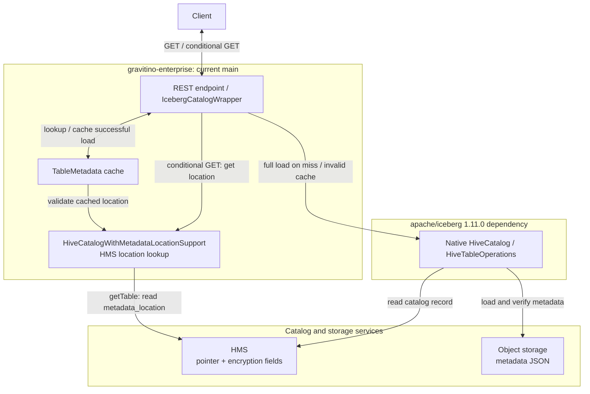
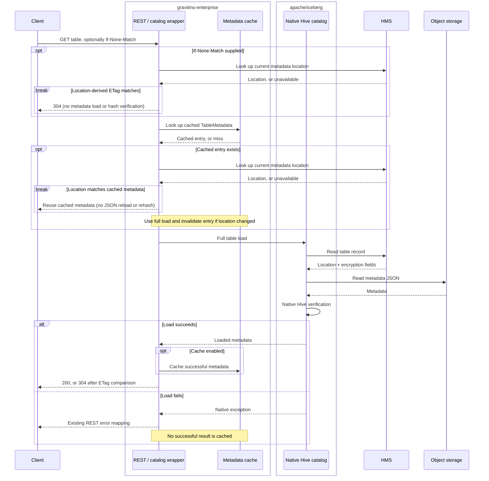
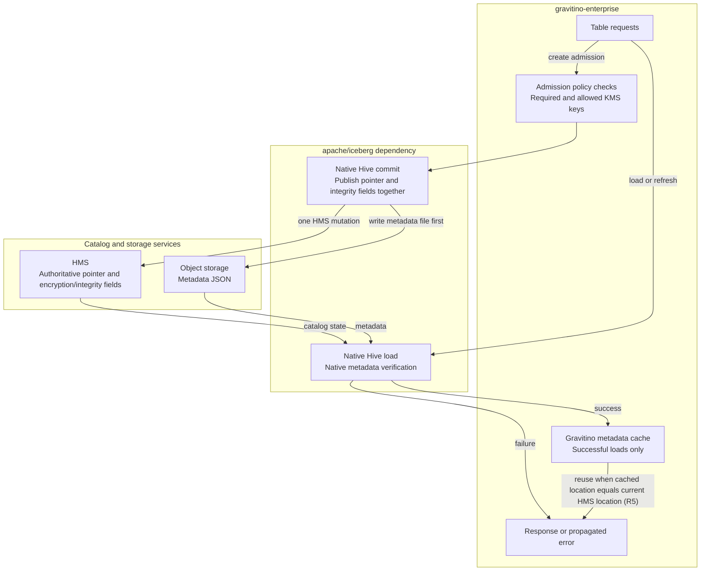
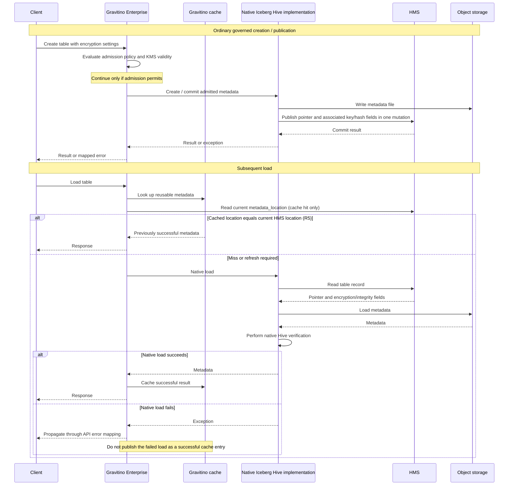

<!--
  Copyright 2026 Datastrato Inc.
-->

# SPIP: Hive Encryption Guarantees and Policy Enforcement

| Field | Value |
| --- | --- |
| Status | Approved — aligned in the review meeting of 2026-09-15 and recorded in the PR discussion (#2027); implementation pending |
| Author | Nevin Zheng ([@nevzheng](https://github.com/nevzheng)) |
| Reviewers | [@roryqi](https://github.com/roryqi), [@jerryshao](https://github.com/jerryshao), [@markhoerth](https://github.com/markhoerth) |
| Created / updated | 2026-09-15 / 2026-09-16 (approved) |
| Parent | [SPIP: Governed Iceberg Table Encryption](../SPIP-governed-iceberg-encryption.md) |
| Related | [ADR #1604](https://github.com/datastrato/gravitino-enterprise/pull/1604), [Hive implementation #1883](https://github.com/datastrato/gravitino-enterprise/pull/1883), [implementation stack](https://app.graphite.com/github/pr/datastrato/gravitino-enterprise/1889) |

## Q1. Goals and requirements — what are we trying to do?

**Retain the established encryption goals and record the accepted Hive-specific guarantees.**
The original SPIP defines the feature; the accepted ADR defines atomic publication. This document
records the accepted Hive read behavior and the adjustments to those agreements (see
[Errata](#errata-adjustments-to-the-adr)).

Each requirement below carries its **Decision**. Existing decisions are not reopened.

### A. Already established — retain these guarantees

#### R1. Atomic publication

**Requirement.** An encrypted table's metadata pointer and integrity fields must be published together.
Readers must not observe a new pointer paired with the previous commit's hash.

**Existing agreement.** [ADR §1][adr-decision] selects backend-local atomic writes: Hive uses one HMS
create/alter mutation. The metadata file itself is outside that transaction; failed publication may
leave an unreferenced file.

**Decision.** Retain this guarantee. Simplifying Hive verification does not reopen atomicity,
supported backend scope, or JDBC's transaction design.

#### R3. Encryption governance

**Requirement.** When an applicable policy requires encryption or restricts KMS keys, evaluate it
and record the result. Integrity verification alone does not establish that a key is allowed by policy.

**Existing agreement.** [SPIP B2][spip-policy] defines create-time governance with report or deny-create
enforcement. The stack implements policy/KMS validation and extends admission to staged publication
and registration; the original SPIP does not separately decide every implementation detail.

**Decision.** Preserve governance while simplifying Hive loads. REPORT can admit policy
violations, but not invalid key input or KMS failures. Ordinary-read checks are the separate R4
question.

#### R6. Safe handling of failed loads

**Requirement.** A failed metadata verification must not become a successful API response or a
reusable response-cache entry.

**Existing agreement.** [ADR §3][adr] requires rejection of invalid metadata before returning or
caching it. Native Iceberg's retained-object lifecycle and Gravitino's server cache are different
boundaries; that distinction needs testing, not a weaker server guarantee.

**Decision.** Retain the server guarantee and test repeated failure, cache/conditional responses,
and recovery. Do not additionally promise safe reuse of arbitrary native operations objects after
failed refreshes.

### B. Hive details to align on

#### R2. Native metadata verification

**Requirement.** Loading an encrypted table should verify its metadata against the catalog's trusted
state. HMS holds the authoritative record; Iceberg's Hive implementation performs verification.

**Existing agreement.** [SPIP A3/B3][spip-integrity] describes integrity on load, and [ADR §3][adr]
requires consistent pointer/hash reads and fail-closed behavior. The accepted main ADR does not
explicitly settle whether native Hive's missing-hash fallback suffices.

**Decision.** Accept native verification without additional Enterprise load checks, including the
missing-hash fallback: with no hash, native Hive checks encryption properties instead of the full
metadata hash. This narrower Hive guarantee adjusts the ADR's fail-closed read wording without
amending the ADR (see [Errata](#errata-adjustments-to-the-adr)). JDBC stays unchanged.

#### R5. Cache freshness

**Requirement.** Define how quickly cached readers must observe catalog changes. Previously verified
metadata can remain internally valid while no longer representing current catalog state.

**Existing agreement.** The SPIP/ADR specify no maximum cache age. Current main checks the HMS
metadata location before reusing a cached entry; the implementation stack under review skipped that
check for Hive.

**Decision.** Retain main's behavior: on each cache hit, compare the current HMS `metadata_location`
with the cached location and reload on change. No maximum cache age is introduced, and warm-cache
reuse that skips the location check is not accepted. Neither a pointer check nor a timeout promises
the catalog cannot change immediately afterward.

#### R7. Error behavior

**Requirement.** Failed verification must return an error under an agreed classification and
disclosure contract.

**Existing agreement.** The [SPIP][spip-integrity] requires exceptions on integrity failures but leaves
detailed mappings open. Native failures are not uniformly typed as integrity errors.

**Decision.** Propagate native errors through existing mappings, without message/stack inspection
or a blanket 400-to-500 conversion. Hash mismatch currently maps to 500; malformed Base64 can map
to 400. These outcomes and native message contents are accepted for now. Typed integrity
exceptions and safer diagnostics are upstream Apache Iceberg work; once available, Gravitino maps
the typed failures without inspecting messages or stack traces.

### C. Scope questions

#### R4. Read-time policy compliance

**Requirement.** Decide whether governance controls admission only or also prevents access when
an existing table no longer satisfies current policy.

**Existing agreement.** [SPIP B2][spip-policy] describes create-time enforcement, not continuous read
authorization. Current dispatchers do not re-evaluate policy on ordinary reads, so admission checks
do not automatically catch policy or out-of-band catalog changes.

**Decision.** Admission-only enforcement for v1: policy is evaluated during create, registration,
overwrite, and staged publication; ordinary reads do not re-evaluate it. If read-time compliance
is required later, explicitly add the operations covered, authoritative key source, freshness, and
report/deny behavior. Existing DENY_CREATE semantics do not define denial of reads.

#### R8. Registration and enrollment

**Requirement.** Registration must publish the metadata admitted.
Registration/overwrite must preserve atomic publication and the table's encryption-key binding.

**Existing agreement.** [ADR §1][adr-decision] requires separately approved enrollment for registration
or overwrite. The stack implements candidate-identity binding and strict overwrite safeguards;
their presence in code is not evidence of separate design approval.

**Decision.** Preserve those safeguards during Hive-load simplification: registration publishes
the admitted candidate, and overwrite keeps atomic publication and the existing key binding. An
existing table may load through native missing-hash fallback yet fail stricter overwrite
admission; keep that distinction explicit.

### D. Reuse this alignment for JDBC

**Align once on shared requirements, then confirm backend-specific differences.** These topics also
apply to supported Gravitino-managed JDBC catalogs. Reusing the agreement can avoid another full
alignment exercise, while leaving JDBC-specific mechanisms and guarantees explicit:

1. **Atomic publication (R1):** publish the table pointer and integrity state together. Hive uses one
   HMS mutation; supported JDBC uses the same database connection and transaction for both writes.
   This does not expand support to arbitrary federated JDBC catalogs.
2. **Policy governance (R3):** enforce required encryption, permitted KMS keys, validation, and audit
   behavior. Integrity verification is not a substitute for policy compliance in either backend.
3. **Enforcement timing (R4):** the accepted admission-time scope applies to both backends.
   Continuous read-time compliance would be an explicit additional requirement, not an implicit
   consequence of enabling integrity checks.
4. **Safe failed loads (R6):** rejected metadata must not become a successful response or cache entry.
   Each backend must qualify its own failure, cache, and recovery paths.
5. **Registration identity and atomic enrollment (R8):** publish the candidate actually checked and
   preserve its key binding. The principle transfers; backend enrollment mechanisms and their
   approval remain explicit rather than being approved by this Hive proposal.
6. **Freshness requirements (R5):** both backends compare the current catalog pointer with the
   cached location on each cache hit. JDBC currently also re-checks the integrity record on cache
   hits; changing that needs a separate JDBC decision.
7. **Verification responsibility (R2):** both backends need a defined trusted source and verification
   contract. Hive can delegate to its native implementation; JDBC retains explicit integrity-record,
   hash, and key verification. Hive's missing-hash fallback does not transfer.
8. **Error-contract principles (R7):** failures should be actionable and disclosure controlled, but
   mappings need not be identical. Preserve JDBC's typed, redacted errors—412 through Iceberg REST
   and 500 through the native Gravitino API—rather than copy Hive's native error mappings.

The benefit is shared product alignment, not identical implementations or permission to weaken
JDBC's existing checks. Confirm the backend-specific differences before applying any change.

#### Hive-specific choices that do not apply to JDBC

- **Trusting HMS and delegating verification to native Hive refresh:** JDBC has no HMS record or
  Hive verifier. It retains its own trusted integrity record and explicit verification.
- **Accepting missing-hash fallback or omitting the independent key comparison:** these are native
  Hive semantics, not replacements for JDBC's hash/key checks.
- **Using one HMS mutation for atomic publication:** JDBC instead uses one database transaction.
- **Propagating native Hive exception mappings:** JDBC retains its existing typed, redacted errors.
- **Removing Hive refresh interception or adding Hive-specific upstream hooks:** these concern the
  Hive implementation, not a reason to remove JDBC transaction or verification machinery.

## Q2. Non-goals and scope requirements — what are we not trying to solve?

These exclusions are part of the accepted contract alongside R1–R8.

- **N1. Hive-specific scope:** this document focuses on Hive, but its decisions and principles can also be applied to JDBC providers.
- **N2. No replacement policy or crypto system:** reuse existing governance; do not build a new policy engine, perform data encryption, or act as a KMS.
- **N3. No continuous compliance by default:** enforce policy at admission, not every read, unless R4 is explicitly expanded.
- **N4. No always-latest read promise:** define acceptable freshness under R5 rather than guaranteeing the catalog cannot change after a check.
- **N5. No arbitrary native-object recovery guarantee:** require safe server responses/cache publication, not safe reuse of retained native operations after failed refreshes.
- **N6. No upstream extension as a predetermined solution:** pursue an extension only if an agreed requirement cannot be met adequately through the existing native path and Gravitino integration.

## Q3. How is it done today, and what are the limits of current practice?

**The gap is complete Gravitino support for the metadata-integrity hash information described in
the [original SPIP][spip-integrity].** Native Iceberg/Hive already provides hash storage and
verification; Gravitino must integrate it with governed encryption and its load/cache paths.

### Current main: native Hive loading with a location-validated cache

Baseline: `datastrato/gravitino-enterprise` **main at
`926fc005320fac09d228e4c9af831cbd2827ef58`**, fetched for this explanation; Iceberg dependency 1.11.0.
This is not the implementation stack under review or the accepted design.

- **HMS** holds the current metadata-file location and encryption fields, including the hash when present.
- **Object storage** holds the metadata JSON.
- **Native Iceberg** loads the file and performs its Hive integrity checks on a full load.
- **Gravitino** caches the loaded `TableMetadata`. Before reusing it, it asks HMS for the current
  location and compares it with the cached location—not the hash.
- **Conditional GET** can return 304 using the current HMS location alone, without a full metadata load.

### Block diagram

Repository boxes show code responsibilities, not separate processes. A location lookup does not
load the JSON or verify its hash.

### Load / cache / conditional-GET sequence

**What the checks mean:** native full-load verification checks the hash when an HMS encryption key
and nonempty hash are present; with a key but no hash, it falls back to encryption-property checks.
Without an HMS key, that encryption-integrity branch is skipped.

The cache uses expire-after-access, **plus a location check on each cache hit**. A changed HMS pointer
stops reuse before expiry. This location-only check misses JSON or hash/key changes at the same
location. A matching conditional ETag likewise does not establish fresh metadata verification.
The catalog can change immediately after a pointer check.

Sources: [main Hive location lookup][main-hive], [main cache validation][main-cache],
[main load/cache and metadata-location paths][main-wrapper],
[main conditional GET][main-get], and [native verification][native-checks].

## Q4. What is new in your approach and why do you think it will be successful?

**Publish integrity metadata atomically, rely on native Iceberg's Hive verification, and retain
Enterprise policy enforcement.** Do not intercept native refresh or track a separate HMS snapshot
for additional load-time hash/key comparisons. This contract was approved on 2026-09-16 (#2027);
implementation is pending.

### Proposed approach: responsibilities

Policy compliance and native integrity verification remain separate. The write path shows ordinary
native publication after admission. Registration/overwrite retains separate candidate checks and
atomic-enrollment safeguards (R8). Object storage is outside the HMS transaction. Cache-hit
validation and conditional GET follow R5: compare the current HMS location before reuse.

### Proposed approach: write, load, and reuse

Native verification includes missing-hash fallback (Q4.A), not mandatory full-hash verification.
Cache freshness (R5) and error mapping (R7) are decided in Q1.

### A. Accept native integrity semantics for Hive loads

| Native condition | Accepted behavior |
| --- | --- |
| HMS encryption key and nonempty hash | Verify metadata against the hash. |
| HMS key but missing/empty hash | Warn; compare encryption key/data-key-length properties instead of the full metadata hash. |
| No HMS encryption key | Skip native encryption-integrity verification. Successful loading does not establish policy compliance. |
| Hash matches but HMS and metadata keys differ | No independent key comparison after hash verification; trust native publication/catalog consistency. |

Accepting this [native contract][native-checks] removes the need to capture the internal HMS snapshot
for additional Enterprise load checks, and with it the rejected refresh interception. It adjusts
the [ADR's][adr] fail-closed Hive read guarantee to permit fallback; the ADR itself is not amended
(see [Errata](#errata-adjustments-to-the-adr)). JDBC remains unchanged; freshness is decided under
R5.
The diagrams above show the proposed responsibilities and flows. See
[Appendix B](#appendix-b-implementation-change-plan) for the implementation delta.

### B. Keep governance separate from integrity

Retain the [policy evaluator][evaluator] and dispatchers. Missing required encryption or disallowed
keys follow `REPORT` versus `DENY_CREATE`. Blank/malformed input, invalid KMS keys, and unavailable
KMS remain validation failures even in `REPORT` mode; the two KMS checks apply only with
`gravitino.encryption.validateKeys=true` (see SPIP-one A2).

**Admission only for v1 (R4).** Reads do not reassess compliance after policy or catalog changes;
read-time enforcement would require the decisions listed under R4. `DENY_CREATE` does not define
read denial.

### C. Keep main's per-hit location check

**Decision (R5): retain main's cache policy.** The implementation stack under review skipped
main's location check for Hive (Q3); its expire-after-access timeout alone can retain stale entries
indefinitely, and that behavior is not accepted. Cache hits compare the current HMS location with
the cached location and reload on change, with no new maximum age. An Iceberg hook does not settle
freshness.

### D. Let requirements determine upstream work

Native verification needs no new Iceberg hook. Stronger same-snapshot checks could require an
`apache/iceberg` extension and release coordination or patched-artifact maintenance. Reusable
integration can move to `apache/gravitino`, but that alone cannot expose Iceberg-local state.

### E. Stronger guarantees: what we learned and the accepted tradeoff

**Implementation experiments, review discussions, and code analysis revealed several costs of
stronger verification:**

1. **More Enterprise-specific machinery:** capturing the HMS snapshot required interception,
   refresh-state tracking, and additional verification logic in `gravitino-enterprise`.
2. **Tighter coupling to Iceberg internals:** reliance on native refresh behavior increased maintenance
   and upgrade risk. This interception approach was rejected on maintainability grounds,
   regardless of passing tests.
3. **Potential upstream work:** avoiding interception led us to explore explicit extension points in
   `apache/gravitino` and/or `apache/iceberg`. Gravitino changes alone cannot expose Iceberg-local state.
4. **Delivery and ownership costs:** an Iceberg extension requires community review and release
   coordination—or maintaining a patched dependency until it is available.

**The accepted design retains atomic publication and policy enforcement and relies on native Hive
verification.** Stronger guarantees remain available where agreed benefits justify their costs;
R1–R8 record the decisions.

The options below describe qualitative implementation, runtime, and maintenance implications, not
delivery estimates. Some were analyzed rather than implemented or benchmarked; the upstream options
were explored and remain available.

#### E1. Require a hash and independently compare encryption keys

This would require a usable metadata hash on every encrypted Hive record and matching metadata/HMS
encryption-key references even after hash verification succeeds. It would reject missing-hash or
inconsistent-key states that native Iceberg may accept. This is useful when every full load must
verify the full hash instead of using native encryption-property fallback, or explicitly establish
key-reference consistency. It does not establish policy compliance.

Checking the exact HMS record consumed by native refresh requires access to that snapshot. Our
attempt added interception and duplicate verification; a supported extension could require changes
and release coordination in `apache/iceberg` (Q4.D). **Decision (R2): accept native Hive
verification and its fallback.**

#### E2. Reevaluate encryption policy when a table is read

This would check whether a table satisfies the applicable encryption policy at read time, beyond
creation or registration. It could help administrators who change allowed keys or encryption
requirements after admission and want subsequent access to report or reject noncompliance. A valid
metadata hash alone does not answer that policy question.

This adds policy resolution, selection of authoritative key state, REPORT versus denial semantics
for reads, and consistent handling of cache hits and conditional GET.
If current KMS state is also required, its availability and freshness become part of the read path.
**Decision (R4): retain admission-time enforcement.** Read-time compliance is an analyzed
extension, not a completed implementation.

#### E3. Check catalog currentness before reusing cached metadata

This would check for catalog changes before returning a cached result, useful when other writers'
changes must become visible before cache expiry. Main's location comparison detects pointer changes,
but misses hash/key or metadata-content changes at an unchanged location. A stronger identity check
would need to define and compare those fields. The catalog can change immediately after either check.

Per-hit checks add HMS traffic and invalidation handling. A bounded cache age offers periodic refresh
with a defined stale interval, without inherently requiring an Iceberg extension. Expire-after-access
alone does not bound staleness for a continuously accessed entry. **Decision (R5): location
validation** — retain main's per-hit HMS location comparison; no bounded age; no-per-hit-check
reuse is not accepted.

#### E4. Return uniformly classified and redacted integrity errors

This would give clients a predictable integrity-failure category and safe message across native
verification paths. It could improve client handling, operator diagnosis, and Hive/JDBC consistency.
Classification and redaction are separate guarantees: hiding sensitive details does not necessarily
require identifying every failure as an integrity error.

Native Hive failures are not uniformly typed. Reliable classification may need a supported upstream
exception contract; inferring it from messages or stack traces is brittle. Redaction also requires
an explicit API-boundary policy and tests. **Decision (R7): no speculative classifier and no
promise of uniform Hive 412 responses.** Native error behavior is accepted for now; typed upstream
exceptions are the path to redaction. JDBC's existing typed-error behavior is preserved.

#### E5. Guarantee safe reuse of any native operations object after a failed refresh

This would prevent a caller retaining a native Iceberg operations object from obtaining rejected
metadata after refresh verification fails. It protects callers that catch an exception and reuse the
object. It exceeds the server requirement: a failed load must not become a successful response or
cache entry.

Native refresh installs metadata before completing verification, so guaranteeing arbitrary retained
object safety may require an `apache/iceberg` lifecycle change and recovery tests. Another Enterprise
refresh wrapper is excluded by the accepted contract. **Decision (R6): guarantee and test the
server response/cache boundary**, including repeated failures and recovery, rather than promise
safe arbitrary native-object reuse. If those server paths cannot meet that boundary, reassess the
implementation before shipping.

## Q5. Who cares? If you are successful, what difference will it make?

Customers know what integrity verifies, when policy applies, and how stale reads may be. Guarantees
are agreed before implementation; engineers can remove refresh machinery without dropping
governance.

## Q6. What are the risks?

- **The accepted contract is specific:** we trust HMS as the authoritative catalog, accept native Iceberg/Hive verification—including missing-hash fallback—and retain atomic publication and admission-time policy enforcement. This does not promise continuous policy compliance or always-current cached reads.

- **Stronger guarantees materially increase scope and cost:** additional verification can require Enterprise-specific interception and state tracking, or upstream extension points and dependency maintenance. Our investigation found these approaches substantially more complex, and the interception approach was rejected. Stronger guarantees are pursued only where an explicit requirement justifies those costs.

- **Contract reduction:** native missing-hash fallback is not full metadata-hash verification. R2 is accepted; the adjustment to the ADR is recorded in the [Errata](#errata-adjustments-to-the-adr).

- **Freshness and enforcement:** R4/R5 determine when policy is checked and how stale cached results may be; both are decided (admission-only; per-hit location check). Indefinitely stale hot entries are excluded by R5.

- **Failure lifecycle:** native Iceberg installs metadata before completing verification. A retained operations object can therefore expose rejected metadata after failure. Inspected server flows discard failed operations and cache only successful results; that boundary still needs regression testing.

- **Error behavior:** native hash mismatch currently maps to 500; malformed Base64 can map to 400. Native errors do not provide JDBC's uniformly typed, redacted integrity-error behavior.

- **Read/write differences:** native fallback may permit loading a table that stricter overwrite-registration checks reject. Preserve those write safeguards and document the difference.

## Q7. How long will it take?

Delivery is tracked as the milestones in Q8 under
[#1148](https://github.com/datastrato/gravitino-enterprise/issues/1148); effort estimates live in
the owning issue rather than in this document. Implementation, review, and testing overlap; the
milestones are workstreams, not a requirement to finish merging before testing. Re-estimate after
JDBC alignment if the agreed scope changes.

## Q8. Milestones and acceptance criteria

These are sub-milestones for the work discussed in this proposal, primarily tracked under
[#1148](https://github.com/datastrato/gravitino-enterprise/issues/1148). They are not a complete
inventory of that issue or the broader encryption project. Other work may be documented separately,
including work outside #1148 that is not covered by this document or alignment meeting. Completing
these milestones does not by itself establish that all parent-issue or release work is complete.

1. **Align on Hive implementation details.** Confirm requirements, tradeoffs, and the implementation
   approach. **Acceptance:** agreement recorded (review meeting of 2026-09-15; PR discussion on
   #2027), proposal approved and merged into the repository. **Done 2026-09-16.**
2. **Document and align on JDBC implementation details.** Write the JDBC proposal, reusing shared
   principles and highlighting backend-specific differences
   ([SPIP: JDBC Encryption Guarantees and Atomic Integrity](SPIP-jdbc-encryption-guarantees-and-atomic-integrity.md)). **Acceptance:** record agreement from
   the alignment meeting, approve the proposal, and merge it into the repository.
3. **Implement, iterate through review, and merge.** Update the stack to match the agreed designs,
   include relevant tests, and address review feedback. **Acceptance:** required checks pass,
   reviewers approve, and the implementation stack is merged.
4. **Complete the validation and verification plan.** Execute the agreed plan and record results,
   gaps, and follow-up work. **Acceptance:** required validation passes and the validation-plan
   owner confirms the results meet the release criteria. Link the plan and confirm its applicable
   scope before execution.

Validation should run alongside implementation and review wherever possible—not wait until after
merge. Track additional work in its owning issue rather than implicitly expanding these milestones.

## Appendix B. Implementation change plan

### Expected code reduction

Rechecking the current proposal against stack `c8c54fff50b30d38b47437c9b1a2682ff78998be` confirms an
inventory of **237 gross removable physical production lines** (including 203 code-bearing lines),
about 39% of the 604-line, four-file Hive subset—not the whole feature. Registration, overwrite, and
JDBC safeguards remain outside that removal inventory.

**200–240 net lines removed (approximately 33–40%) remains a conditional planning estimate, not a
verified diff or bounded range.** Cache-gate additions, formatting, and the unresolved freshness
choice affect the final count. The estimate excludes freshness redesign and read-time policy work;
it is not a delivery estimate or a tested implementation.

### Work and verification

**Requirements approved 2026-09-16.** Main ownership is #1883, with coordinated descendant changes
where registration, response handling, or tests depend on it. No new public hook is proposed.

| Step | Delta | Verification / boundary |
| --- | --- | --- |
| **1. Qualify native failure behavior** | Exercise native operations through built-in server paths before removing the wrapper. | Repeat failed requests, then repair at the same/new location. No successful response, cache admission, or cold 304 while failure persists. Arbitrary retained native objects are not covered. |
| **2. Remove refresh interception** | Delete `GravitinoHiveTableOperations` and `RefreshSnapshotPool`; inherit public native `HiveCatalog.newTableOps()`. Remove duplicate FileIO/KMS reflection and dead DEK plumbing. | Native factory retains configuration/KMS wiring. Verify hash success/failure, fallback, missing key, and native errors. Retain HMS-client access still used by catalog operations. |
| **3. Restore cache/conditional paths** | Remove Hive's strict `isCurrentMetadata()` and interface membership; Hive stays in main's per-hit location gate. | Warm hits compare the current HMS `metadata_location` with the cached location and reload on change (R5); cold/disabled-cache 304 still requires native loading. JDBC currentness is unchanged. No TTL change. |
| **4. Retain governance and writes** | Keep resolver/evaluator, API dispatchers, KMS validation, audit, registration identity, and strict overwrite verification. Delete helpers only after checking remaining callers. | Preserve required/allowed keys, REPORT/DENY_CREATE, staged admission, atomic publication, key immutability, and registration candidate binding. Missing-hash loads and overwrite admission may differ. |
| **5. Review and deliver** | Retarget obsolete strict-load tests, run affected suites, review the diff, restack descendants, and refresh PR descriptions. | Report actual results and unavailable tests. Publish after authorization; no CI, licensing, JDBC schema, or backend-scope changes. |

Tests include `TestHiveCatalogWithMetadataLocationSupport`, `TestLocalMetadataCache`,
`TestIcebergCatalogWrapper`, and `TestIcebergConditionalMetadataIntegrity`, plus policy and registration
coverage. Run `IcebergEncryptionHiveCatalogIT` for native Hive integrity behavior,
`IcebergEncryptionHiveIntegrityIT` for governed cross-API behavior and staged publication, and
`IcebergEncryptionAtomicIntegrityIT` for PostgreSQL and MySQL regression coverage.
Do not count deletion of wrapper-specific tests as proof that their failure cases remain covered.

Verification must cover native hash success/failure and missing-hash fallback, accepted missing-key
and inconsistent-key behavior, repeated failures without successful responses/cache entries, and
recovery after repair. Warm/cold/disabled-cache, invalidation, and conditional GET must meet the
agreed contract. Preserve required/allowed keys, KMS validity, REPORT/DENY_CREATE, atomic publication,
registration identity, overwrite safeguards, and JDBC regression coverage. These are planned checks,
not completed results.

Implementation references: [native factory][native-factory], [response/cache gate][wrapper], and
[policy evaluator][evaluator]. If native failure containment needs another interception layer, bring
that concrete gap back for a decision rather than recreating the rejected design.

## Appendix C. Evidence and status

Approved 2026-09-16 (#2027). Source trace and assessment used the implementation stack at
`c8c54fff50b30d38b47437c9b1a2682ff78998be` and Iceberg 1.11.0
`028d06dc55a93143f3e4792e8cd501e056fffa37`; Q3 uses main
`926fc005320fac09d228e4c9af831cbd2827ef58`. Assessments were made from source, not from
prototypes or benchmarks.

## Errata: adjustments to the ADR

Where applicable, this document adjusts the course set by the [accepted ADR][adr-decision]
without amending the ADR itself. The ADR's atomic-publication decision, supported-backend scope,
and JDBC guarantees stand. For the built-in Hive backend, the following adjustments were approved
on 2026-09-16 (#2027):

| ADR statement | Adjustment |
| --- | --- |
| §3: reads obtain a consistent pointer and hash and fail closed before returning or caching invalid metadata. | Hive reads use Iceberg's native verification, including the missing-hash fallback (R2): with an HMS encryption key and no hash, encryption properties are compared instead of the full metadata hash. Fail-closed applies to hash mismatch. JDBC is unchanged. |
| §3: writers outside Gravitino can leave governed tables unavailable until approved repair. | Hive records with a key but no hash load with a warning through native fallback; they may still fail stricter overwrite admission (R8). JDBC matches Hive: such a record loads with a warning, its first commit writes the integrity row, and register-overwrite onto it is refused. |
| Cache freshness (not stated). | Cache hits compare the current HMS `metadata_location` with the cached location and reload on change; no maximum age (R5). |
| Error contract (not stated). | Hive verification failures propagate native Iceberg errors through the existing mappings; JDBC keeps typed, redacted errors (R7). |
| Implementation boundary (not stated). | No Enterprise interception of native Hive refresh: `GravitinoHiveTableOperations` and `RefreshSnapshotPool` are removed (Appendix B). |

[adr]: https://github.com/datastrato/gravitino-enterprise/blob/926fc005320fac09d228e4c9af831cbd2827ef58/design-docs/iceberg-table-encryption/design-trusted-metadata-integrity.md#3-consequences
[adr-decision]: https://github.com/datastrato/gravitino-enterprise/blob/926fc005320fac09d228e4c9af831cbd2827ef58/design-docs/iceberg-table-encryption/design-trusted-metadata-integrity.md#1-decision
[spip-policy]: https://github.com/datastrato/gravitino-enterprise/blob/926fc005320fac09d228e4c9af831cbd2827ef58/design-docs/iceberg-table-encryption/SPIP-governed-iceberg-encryption.md#b2-encryption-policy
[spip-integrity]: https://github.com/datastrato/gravitino-enterprise/blob/926fc005320fac09d228e4c9af831cbd2827ef58/design-docs/iceberg-table-encryption/SPIP-governed-iceberg-encryption.md#b3-integrity-on-load
[native-checks]: https://github.com/apache/iceberg/blob/028d06dc55a93143f3e4792e8cd501e056fffa37/hive-metastore/src/main/java/org/apache/iceberg/hive/HiveTableOperations.java#L574
[native-factory]: https://github.com/apache/iceberg/blob/028d06dc55a93143f3e4792e8cd501e056fffa37/hive-metastore/src/main/java/org/apache/iceberg/hive/HiveCatalog.java#L699
[evaluator]: https://github.com/datastrato/gravitino-enterprise/blob/c8c54fff50b30d38b47437c9b1a2682ff78998be/core/src/main/java/org/apache/gravitino/encryption/IcebergEncryptionPolicyEvaluator.java#L66
[wrapper]: https://github.com/datastrato/gravitino-enterprise/blob/c8c54fff50b30d38b47437c9b1a2682ff78998be/iceberg/iceberg-common/src/main/java/org/apache/gravitino/iceberg/common/ops/IcebergCatalogWrapper.java#L334
[enterprise-refresh]: https://github.com/datastrato/gravitino-enterprise/blob/c8c54fff50b30d38b47437c9b1a2682ff78998be/iceberg/iceberg-common/src/main/java/org/apache/iceberg/hive/GravitinoHiveTableOperations.java#L63
[native-refresh]: https://github.com/apache/iceberg/blob/028d06dc55a93143f3e4792e8cd501e056fffa37/hive-metastore/src/main/java/org/apache/iceberg/hive/HiveTableOperations.java#L169
[main-hive]: https://github.com/datastrato/gravitino-enterprise/blob/926fc005320fac09d228e4c9af831cbd2827ef58/iceberg/iceberg-common/src/main/java/org/apache/iceberg/hive/HiveCatalogWithMetadataLocationSupport.java#L81
[main-cache]: https://github.com/datastrato/gravitino-enterprise/blob/926fc005320fac09d228e4c9af831cbd2827ef58/iceberg/iceberg-common/src/main/java/org/apache/gravitino/iceberg/common/cache/BaseTableMetadataCache.java#L61
[main-wrapper]: https://github.com/datastrato/gravitino-enterprise/blob/926fc005320fac09d228e4c9af831cbd2827ef58/iceberg/iceberg-common/src/main/java/org/apache/gravitino/iceberg/common/ops/IcebergCatalogWrapper.java#L270
[main-get]: https://github.com/datastrato/gravitino-enterprise/blob/926fc005320fac09d228e4c9af831cbd2827ef58/iceberg/iceberg-rest-server/src/main/java/org/apache/gravitino/iceberg/service/rest/IcebergTableOperations.java#L330
