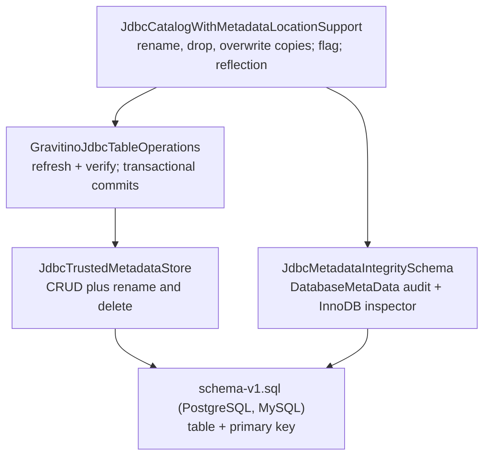
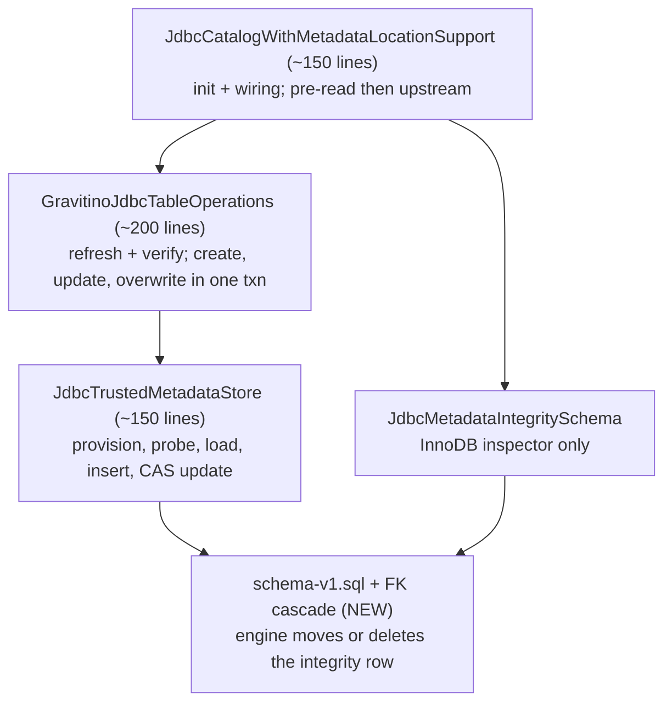
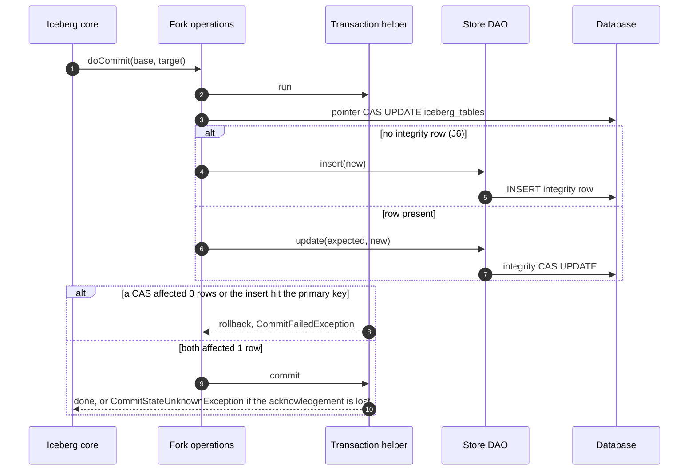

<!--
  Copyright 2026 Datastrato Inc.
-->

# SPIP: JDBC Encryption Guarantees and Atomic Integrity

| Field             | Value                                                                                                                                                                                                                                                                                                                                                                                                                                                                                         |
| ----------------- | --------------------------------------------------------------------------------------------------------------------------------------------------------------------------------------------------------------------------------------------------------------------------------------------------------------------------------------------------------------------------------------------------------------------------------------------------------------------------------------------- |
| Status            | Proposed — decisions aligned 2026-09-16; to be finalised against the reworked code before implementation review                                                                                                                                                                                                                                                                                                                                                                               |
| Author            | Nevin Zheng ([@nevzheng](https://github.com/nevzheng))                                                                                                                                                                                                                                                                                                                                                                                                                                        |
| Reviewers         | [@roryqi](https://github.com/roryqi), [@jerryshao](https://github.com/jerryshao), [@markhoerth](https://github.com/markhoerth)                                                                                                                                                                                                                                                                                                                                                                |
| Created / updated | 2026-09-16 / 2026-09-17                                                                                                                                                                                                                                                                                                                                                                                                                                                                       |
| Parent            | [SPIP: Governed Iceberg Table Encryption](../SPIP-governed-iceberg-encryption.md)                                                                                                                                                                                                                                                                                                                                                                                                             |
| Sibling           | [SPIP: Hive Encryption Guarantees and Policy Enforcement](SPIP-hive-encryption-guarantees-and-policy-enforcement.md)                                                                                                                                                                                                                                                                                                                                                                          |
| Related           | [ADR #1604](https://github.com/datastrato/gravitino-enterprise/pull/1604), JDBC implementation [#1884](https://github.com/datastrato/gravitino-enterprise/pull/1884) · [#1894](https://github.com/datastrato/gravitino-enterprise/pull/1894) · [#1885](https://github.com/datastrato/gravitino-enterprise/pull/1885) · [#1888](https://github.com/datastrato/gravitino-enterprise/pull/1888), [implementation stack](https://app.graphite.com/github/pr/datastrato/gravitino-enterprise/1889) |

## Q1. Goals and requirements — what are we trying to do?

**Keep the JDBC integrity guarantee exactly as the ADR states it, and deliver it with the smallest
permanent Enterprise surface.** The [Hive sibling](SPIP-hive-encryption-guarantees-and-policy-enforcement.md)
recorded the shared requirements R1–R8 and asked JDBC to confirm its backend-specific answers.
This document records those answers and the JDBC-only decisions J1–J5. Existing decisions are not
reopened.

### A. Shared requirements — JDBC answers

#### R1. Atomic publication

**Requirement.** The catalog pointer and the trusted integrity fields advance together or not at all.

**Decision.** Retained, with two mechanisms by operation class:

- *Create, commit, register-overwrite*: one JDBC connection and transaction carry two statements, a
  compare-and-swap on `iceberg_tables.metadata_location` and a compare-and-swap on the
  `iceberg_metadata_integrity` row. Either statement affecting zero rows rolls both back.
- *Rename and drop*: the integrity row's key is a foreign key to `iceberg_tables` with
  `ON UPDATE CASCADE ON DELETE CASCADE`. Upstream `JdbcCatalog` renames with a single `UPDATE` and
  drops with a single `DELETE`, in autocommit; the engine moves or removes the integrity row inside
  that statement. No Enterprise transaction wraps rename or drop. See [J1](#j1-lifecycle-by-referential-action).

#### R2. Verification responsibility

**Requirement.** A defined trusted source and an explicit verification contract.

**Decision.** Unchanged in substance. The trusted source is the catalog-local
`iceberg_metadata_integrity` row, read in one `LEFT JOIN` with the pointer row. Every refresh
verifies the metadata file's hash and key against that row through `IcebergMetadataIntegrity.verify`
and fails closed on a mismatch. A table whose metadata names a key but has no integrity row is
handled like Hive's missing hash: the load logs a warning and proceeds, and the next commit writes
the row; see [J6](#j6-encrypted-tables-without-an-integrity-row-align-with-hive).

#### R3. Encryption governance and R4. Enforcement timing

**Decision.** As the parent SPIP and the Hive sibling: admission-time enforcement on create,
registration, overwrite and staged publication; no read-time policy re-evaluation, including for
a table without integrity state (J6). The catalog performs no policy checks; it publishes what
admission handed it.
An encrypted table is at least format version 3; see [SPIP: Encryption and Iceberg format version](SPIP-encryption-format-version.md).

#### R5. Cache freshness

**Requirement.** A cache hit must not serve metadata the catalog no longer points at.

**Decision.** Mirror Hive. Each cache hit compares the backend's current `metadata_location` with
the cached entry (for JDBC, one indexed `SELECT` on `iceberg_tables`) and reloads on change. The
per-hit re-verification of the integrity row that the earlier JDBC implementation added is removed;
hashes are verified on refresh only. The accepted staleness window is the same for both backends.

#### R6. Safe handling of failed loads

**Decision.** Retained. `MetadataIntegrityException` and `NotFoundException` are not retried inside
the refresh loader, a failed refresh requests a fresh refresh next time, and nothing rejected
enters the cache.

#### R7. Error behavior

**Decision.** Retained. JDBC keeps its typed, redacted integrity failures: HTTP 412 through the
Iceberg REST catalog and a typed 500 through the Gravitino REST API. Key transitions attempted
through re-registration (enroll, rekey, strip) are one `IllegalArgumentException`, HTTP 400.

#### R8. Registration and enrollment

**Decision.** Retained and shared with Hive. Registration parses the metadata file once and
publishes that object. Overwrite verifies the current metadata against the trusted row inside the
transaction and then requires the encryption key binding to be unchanged
(`IcebergMetadataIntegrity.requireSameEncryptionKey`). Registering an encrypted external file is
an admission decision, not a catalog decision. A table already in the catalog without an integrity
row is enrolled by its first commit, without a policy check (J6).

### B. JDBC-only decisions

#### J1. Lifecycle by referential action

**Decision.** Rename and drop are upstream `JdbcCatalog` operations. The Enterprise catalog keeps
two thin overrides that read the pointer-plus-integrity join first and, only when the table is
encrypted, load and verify it through the integrity-aware operations before delegating to
`super.renameTable` / `super.dropTable`. Plain tables delegate directly with no metadata file read.
The overrides contain no SQL and open no transaction.

**Rationale.** The previous implementation re-implemented upstream rename and drop with copied SQL
to update the integrity row in the same transaction. The foreign key gives the same atomicity from
the engine and removes that copy, the pointer helpers, and the DAO's rename and delete statements.
Proven on PostgreSQL 13 and 16 and MySQL 8.0 through upstream `JdbcCatalog` on 2026-09-16.

#### J2. The DDL is the schema

**Decision.** The dialect DDL scripts (`postgresql/schema-v1.sql`, `mysql/schema-v1.sql`) are the
only definition of `iceberg_metadata_integrity`. At initialize the catalog either executes the
script (`jdbc-initialize=true`, the default) or runs one zero-row probe query against the table
(`jdbc-initialize=false`). The `DatabaseMetaData`-based column, nullability and primary-key audit
is removed. The MySQL storage-engine inspector (both tables must be InnoDB) and the transaction
support check stay, because create, commit and overwrite still need a transactional engine.

**Operator contract.** Run Iceberg's own DDL first, so `iceberg_tables` exists when the foreign key
is declared. On MySQL the provisioning user needs the `REFERENCES` privilege on `iceberg_tables`, a
grant given after the catalog connected is not visible until it reconnects, both tables must be
InnoDB, and neither table should declare an explicit character set (both then inherit the database
default and the key columns match). `foreign_key_checks` must remain enabled. Presence of the
foreign key is not validated at startup; see [G3](#g3-no-startup-validation-of-the-foreign-key).

#### J3. One bounded fork of the table operations

**Decision.** `GravitinoJdbcTableOperations` is the only class that executes pointer SQL. It keeps
the refresh-time verification, the transactional create and update, the two private pointer
statements copied from upstream `JdbcUtil`, and a package-private `overwrite` used by
register-overwrite. Its class documentation names the Iceberg version it tracks (1.11.0) and the
single-`UPDATE` rename assumption behind J1. Shadowed upstream fields, precondition copies, the
duplicated exception chain and the availability-flag branches are removed.

**Upstream follow-up.** A no-op-by-default JDBC commit extension in Apache Iceberg, invoked around
the pointer mutation with the same connection, would let this fork shrink to the integrity delta
alone and would remove the need to read `JdbcCatalog`'s private fields. It is tracked as a
follow-up, not a prerequisite. Until then the catalog keeps its three reflective reads
(`catalogName`, `connections`, `schemaVersion`); a future rename of those fields fails loudly at
startup.

#### J4. One capability, two startup modes

**Decision.** Whether a catalog supports atomic metadata integrity is computed once at initialize
from the real connection (provision or probe succeeded, product is PostgreSQL or MySQL, InnoDB on
MySQL) and exposed by the catalog. Policy code consumes that answer; it no longer infers support
from driver class names or URI prefixes.

- **Governed** catalog (an encryption policy applies) whose integrity store cannot be provisioned
  or probed: initialize throws once and the catalog is closed. Nothing is served.
- **Non-governed** catalog in the same state: one warning, and the catalog constructs upstream's
  plain `JdbcTableOperations`. Tables work; encrypted tables in that catalog are not verified.
  This is the existing best-effort semantics, kept.

#### J5. Accepted edge cases

**Decision.** Two gaps are accepted and documented rather than closed; both share one patch. See
[Errata](#errata-jdbc-known-gaps-and-adjustments-to-the-adr).

#### J6. Encrypted tables without an integrity row align with Hive

**Context.** An encrypted table can have a pointer row and no integrity row: written outside an
integrity-aware catalog (an engine's own `JdbcCatalog`, or this catalog in plain upstream mode, J4),
or left by the rename gaps G1 and G3. Failing closed on it would differ from Hive, where native
Iceberg warns on a missing hash and loads (review thread on this SPIP).

**Decision.** Match Hive's missing-hash behaviour. Revised 2026-09-17; the earlier upgrade-only
decision is withdrawn.

| Operation          | Hive, no hash                                                                         | JDBC, no row                                                      |
| ------------------ | ------------------------------------------------------------------------------------- | ----------------------------------------------------------------- |
| Load               | when HMS holds a key: warn, compare the HMS key id and DEK length with the file, load | warn on every uncached load, load; no second key copy to compare  |
| Commit             | key unchanged; the commit writes the hash                                             | key unchanged; the commit inserts the row in the same transaction |
| Register-overwrite | refused                                                                               | refused                                                           |
| Rename, drop       | proceed                                                                               | proceed                                                           |
| Enrollment         | next commit                                                                           | first commit, or drop and register                                |

- **No policy check on load or on the enrolling commit.** Policy stays at admission (R3/R4).
- **No hash is written during a read.** A table becomes verified through its first commit, or by
  drop and register.
- **No batch enrollment tool**, as for Hive. The shipped tooling verifies the side-table schema only.
- **A row whose location differs from the pointer still fails closed.**

**Trust boundary.** The catalog database, including `iceberg_metadata_integrity`, is trusted.
Deleting or editing its rows is out of scope, as it is for the pointer rows themselves. Until its
first commit, the table's metadata file is not hash-verified, so a change to it in object storage
before that commit is trusted by the commit; accepted as Hive parity.

Per-path behaviour, code changes and tests: [design: JDBC encrypted tables without an integrity
row](design-missing-integrity-row.md).

## Q2. Non-goals and scope requirements — what are we not trying to solve?

- Federated, H2, SQLite, memory and custom JDBC backends are not governed-encryption backends.
- No startup validation of the foreign key or its cascade rules (operator responsibility, G3).
- No rename-time transactional guarantee beyond the pre-read (G2).
- No change to policy resolution, KMS validation or audit; those belong to the governance batch.
- No hash written during a read; a table without an integrity row is not enrolled by loading it (J6).
- The Apache Iceberg commit extension is a follow-up, not part of this proposal.

## Q3. How is it done today, and what are the limits of current practice?

At the tip of the implementation stack the JDBC integrity path is about 2,270 lines of Enterprise
code across five classes:

- a 630-line catalog that re-implements upstream rename, drop and overwrite with copied SQL,
  carries an availability flag read fifteen times, and reads three private upstream fields;
- a 426-line table-operations fork that shadows upstream state and copies its refresh, commit and
  exception paths;
- a 396-line store with rename and delete statements and the identity predicate spelled five times;
- a schema class that re-derives the DDL contract through `DatabaseMetaData` and audits it at startup;
- the two DDL scripts, whose column contract is restated in Java constants and again in tests.

The reviewer's inventory on the stack identified the same invariant implemented in several layers
and concluded the code must be reduced rather than patched. Every guarantee above is preserved by
the current code; the cost is maintenance across Iceberg upgrades.



## Q4. What is new in your approach and why do you think it will be successful?

**Let the database and upstream Iceberg do what the Enterprise code copied from them.** Three
moves, all decided:

1. **The database takes over rename and drop** (J1). The foreign key cascade gives atomicity from
   the engine; the catalog keeps a pre-read for encrypted tables only.
2. **The DDL is the single schema truth** (J2). Provision or probe at initialize; the audit goes;
   the inspector and the transaction check stay.
3. **The catalog reads facts instead of re-deriving them** (J4, R5). One pointer compare per cache
   hit, one capability from the real connection, one initialize-time mode decision.



### Rename of an encrypted table

```mermaid
sequenceDiagram
  autonumber
  participant C as Client
  participant K as Our catalog
  participant S as Store DAO
  participant U as Upstream JdbcCatalog
  participant D as Database
  C->>K: renameTable(from, to)
  K->>S: load(from)
  S-->>K: pointer row + integrity columns
  opt integrity columns present (encrypted)
    K->>K: newTableOps(from).current() verifies; fails closed if bad
  end
  K->>U: super.renameTable(from, to)
  U->>D: UPDATE iceberg_tables SET namespace, name WHERE key
  D->>D: ON UPDATE CASCADE moves iceberg_metadata_integrity row
  D-->>C: renamed
```

### Commit of an encrypted table



### A. Why the cascade is safe to rely on

Upstream `iceberg_tables` has a composite primary key on `(catalog_name, table_namespace,
table_name)`; rename is an in-place `UPDATE` of those columns and drop is a `DELETE`; commit and
overwrite touch only the location columns; `JdbcCatalog.initialize` creates `iceberg_tables`
eagerly before the Enterprise DDL runs; nothing reads the integrity row after a drop; the V0 to V1
schema migration does not touch the referenced columns. Each of these was read in the Iceberg
1.11.0 sources and then observed on real PostgreSQL 13 and 16 and MySQL 8.0 containers through
upstream `JdbcCatalog` on 2026-09-16, together with the MySQL edge cases listed under J2.

### B. Why the pre-read is enough

The guarantee users rely on is "bad metadata is never read", and it is enforced on the read path in
every journey. The pre-read moves the error for an already-broken encrypted table from the next
load to the rename itself, at the cost of one join and one file read on that operation only. Making
the pre-read and the rename one transaction would require owning rename SQL again; it is the
documented patch for G1 and G2, not part of this proposal.

### C. What is deliberately unchanged

Reflection into `JdbcCatalog`'s private fields (J3), the two-statement transaction for create,
commit and overwrite, the MySQL InnoDB inspector, the transaction support check, the typed redacted
errors, and the governed versus non-governed startup semantics.

## Q5. Who cares? If you are successful, what difference will it make?

- **Reviewers and maintainers:** one documented fork instead of copies in five classes; Iceberg
  upgrades re-verify one class and one DDL assumption.
- **Operators:** the integrity table is provisioned from one script with a stated prerequisite
  order and privilege, and startup failures name the database error.
- **Data users:** no visible change. Same errors, same status codes, same configuration.

## Q6. What are the risks?

| Risk                                                                                                                                   | Consequence                                                                                                                                              | Mitigation                                                                                                          |
| -------------------------------------------------------------------------------------------------------------------------------------- | -------------------------------------------------------------------------------------------------------------------------------------------------------- | ------------------------------------------------------------------------------------------------------------------- |
| Upstream changes rename to delete-plus-insert                                                                                          | cascade deletes the integrity row; the renamed table then loads with a warning and its next commit writes the row (J6)                                   | contract test through upstream `renameTable` on every Iceberg bump; version pinned in the fork's documentation (G1) |
| Tamper between the pre-read and the rename                                                                                             | rename succeeds; next load fails closed                                                                                                                  | accepted; patch documented (G2)                                                                                     |
| Operator provisions without the foreign key or with mismatched charset, missing `REFERENCES`, MyISAM parent, or `foreign_key_checks=0` | DDL fails with the engine's error, or a renamed encrypted table loses its integrity row and loads with a warning under J6 (its old-name row is orphaned) | documented operator contract (J2, G3)                                                                               |
| Iceberg renames a private field the catalog reads reflectively                                                                         | catalog fails at startup                                                                                                                                 | loud failure; upstream extension tracked (J3)                                                                       |
| Non-governed catalog with a missing integrity store serves unverified encrypted tables                                                 | existing best-effort semantics                                                                                                                           | governed catalogs fail closed; documented (J4)                                                                      |
| An encrypted table has no integrity row (written outside Gravitino)                                                                    | loads with a warning; its metadata file is not hash-verified until its first commit writes the row                                                       | Hive-aligned (J6)                                                                                                   |

## Q7. How long will it take?

One build session of three checkpoints (store, fork, catalog) on the implementation stack, followed
by the capability change, the integration suite on both databases, and the documentation update.
The feasibility spike is complete.

## Q8. Milestones and acceptance criteria

1. **Align on JDBC implementation details.** **Acceptance:** decisions J1–J5 and the R answers
   recorded and agreed. **Done 2026-09-16.**
2. **Prove the cascade on real databases.** **Acceptance:** rename and drop through upstream
   `JdbcCatalog` on PostgreSQL and MySQL move or delete the integrity row; edge cases recorded.
   **Done 2026-09-16.**
3. **Rework the stack.** Store, fork and catalog per Q4; fold the three JDBC pull requests into
   one. **Acceptance:** unit suite and the PostgreSQL plus MySQL contract suite green; the folded
   pull request reviewed.
4. **Cross-API acceptance on both databases.** **Acceptance:** the cross-API integrity suite runs
   on PostgreSQL and MySQL and includes the rename and drop journey.
5. **Documentation.** Operator contract, this proposal finalised against the code, the parent
   SPIP's interim errata replaced by a link here.
6. **Upstream follow-ups.** Apache Iceberg issues for the JDBC commit extension and for a typed
   integrity exception filed.

## Appendix B. Implementation change plan

| Unit                  | Result                                                                                                                                                                                                 |
| --------------------- | ------------------------------------------------------------------------------------------------------------------------------------------------------------------------------------------------------ |
| Store                 | DDL gains the foreign key; store becomes a five-method DAO with one record type; schema class keeps the InnoDB inspector only; a PostgreSQL plus MySQL contract suite replaces the mocked schema tests |
| Fork                  | `GravitinoJdbcTableOperations` keeps refresh-verify, transactional create and update, two pointer statements, `overwrite`; version pinned in its documentation                                         |
| Catalog               | initialize with provision or probe and the two modes; capability exposed; thin rename and drop overrides; register-overwrite delegates to the fork; no SQL                                             |
| Capability            | policy code consumes the catalog's answer; driver and URI inference removed                                                                                                                            |
| Tests                 | cross-API suite parameterised over PostgreSQL and MySQL; rename and drop journey added                                                                                                                 |
| Missing integrity row | warn on load, row inserted by the first commit, overwrite refused (J6); schema verify tooling with a contract test on PostgreSQL and MySQL                                                             |
| Docs                  | operator contract; ADR restored to its accepted text; errata below                                                                                                                                     |

## Appendix C. Evidence and status

- Feasibility spike, 2026-09-16: three parameterised tests on PostgreSQL 13, PostgreSQL 16 and
  MySQL 8.0 through upstream `JdbcCatalog`; zero failures; orphan rows rejected (SQLSTATE 23503 on
  PostgreSQL, error 1452 on MySQL); V0 to V1 `ALTER` keeps the cascade; MySQL charset, privilege,
  `foreign_key_checks` and MyISAM cases characterised.
- Independent design review of J1, 2026-09-16: sound with amendments; amendments adopted (autocommit
  wording, inspector and transaction check kept, test fixtures rewritten, operator contract).

## Errata: JDBC known gaps and adjustments to the ADR

The [accepted ADR][adr-decision] stands unamended. The following are recorded here instead.

### G1. Cascade relies on upstream rename being a single `UPDATE`

If a future Iceberg release renamed by deleting and re-inserting the pointer row, the cascade would
delete the integrity row. **Journey:** renaming an encrypted table after such an upgrade leaves it
without an integrity row, so the next load warns and the next commit writes the row (J6); drop,
commit, overwrite and plain tables are unaffected. **Guard:** a contract test renames a table with a live integrity row through upstream
`JdbcCatalog` on both databases, and the fork's documentation pins the Iceberg version. **Patch if
needed:** run the rename inside an Enterprise transaction (`SELECT … FOR UPDATE` on both rows, then
the rename `UPDATE`), about sixty lines including the copied upstream SQL.

### G2. Pre-read and rename are two statements

The encrypted-table pre-read and upstream's rename or drop run as separate autocommit statements.
**Journey:** a tamper in that gap passes the rename and is caught on the next load. Nothing is read
unverified. **Patch:** the same transaction as G1.

### G3. No startup validation of the foreign key

A table provisioned without the foreign key, with a mismatched character set, without the
`REFERENCES` privilege, on a MyISAM parent, or under `foreign_key_checks=0` is not detected at
startup. **Journey:** the DDL fails with the engine's error at provisioning time, or, for a missing
key, an encrypted table loses its integrity row on rename and then loads under J6. Treated as
operator error and documented under J2; a startup check is the first addition if this is met in the
field.

### Adjustments to the ADR

| ADR statement                                                                                                               | JDBC adjustment                                                                                                                                                              |
| --------------------------------------------------------------------------------------------------------------------------- | ---------------------------------------------------------------------------------------------------------------------------------------------------------------------------- |
| §1: JDBC rename and drop must update or delete the hash in the same transaction.                                            | The engine performs the update or delete inside upstream's single autocommit statement through the foreign key cascade (J1); no Enterprise transaction wraps rename or drop. |
| §1: supported options — JDBC.                                                                                               | Limited to PostgreSQL and MySQL with InnoDB; support is computed from the live connection at initialize (J4).                                                                |
| §3: reads obtain a consistent pointer and hash through a join.                                                              | Unchanged. Cache hits compare the pointer only; the hash is verified on refresh (R5).                                                                                        |
| §1 (`design-trusted-metadata-integrity.md`): encrypted records without trusted state are unsupported and fail closed in v1. | JDBC aligns with Hive (J6): such a table loads with a warning, its first commit inserts the row, and register-overwrite is refused.                                          |
| §3: JDBC must permit side-table migration.                                                                                  | Provisioning is one dialect DDL script executed at initialize or run by the operator after Iceberg's DDL (J2).                                                               |

[adr-decision]: https://github.com/datastrato/gravitino-enterprise/blob/926fc005320fac09d228e4c9af831cbd2827ef58/design-docs/iceberg-table-encryption/design-trusted-metadata-integrity.md#1-decision
