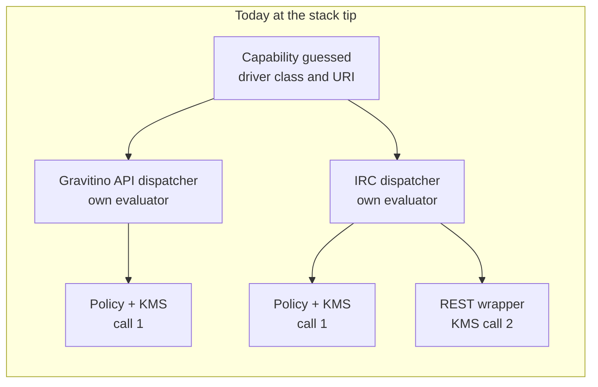
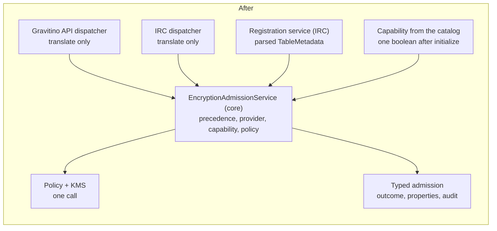
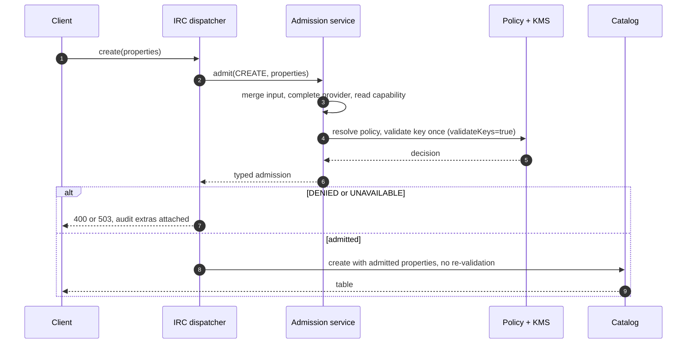
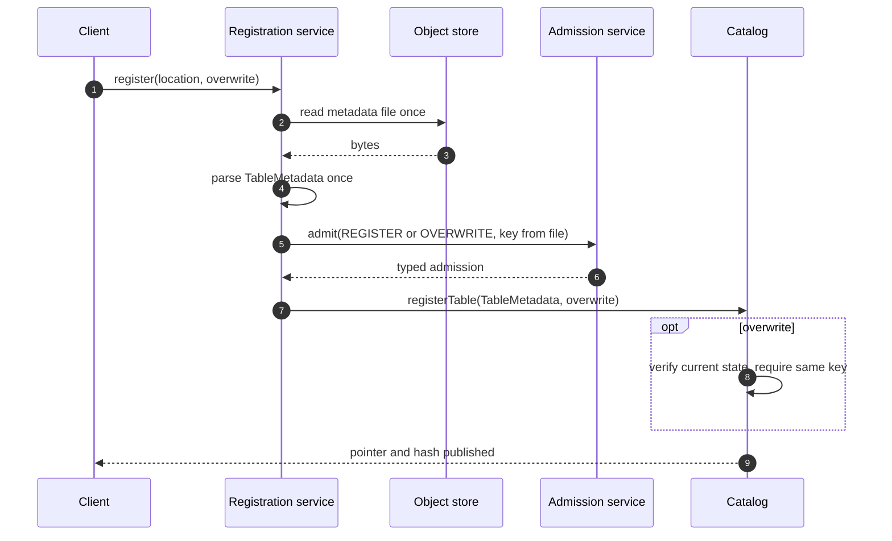
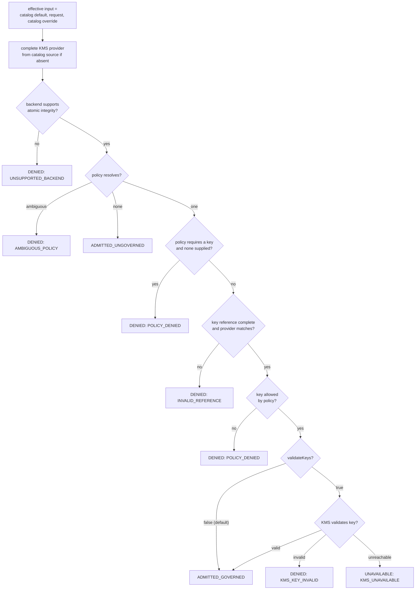

<!--
  Copyright 2026 Datastrato Inc.
-->

# SPIP: One Encryption Admission Path

| Field | Value |
| --- | --- |
| Status | Proposed — decisions aligned 2026-09-16; to be finalised against the reworked code before implementation review |
| Author | Nevin Zheng ([@nevzheng](https://github.com/nevzheng)) |
| Reviewers | [@roryqi](https://github.com/roryqi), [@jerryshao](https://github.com/jerryshao), [@markhoerth](https://github.com/markhoerth) |
| Created / updated | 2026-09-16 / 2026-09-16 |
| Parent | [SPIP: Governed Iceberg Table Encryption](../SPIP-governed-iceberg-encryption.md), sections [B2](../SPIP-governed-iceberg-encryption.md#b2-encryption-policy) and [B3](../SPIP-governed-iceberg-encryption.md#b3-integrity-on-load) |
| Siblings | [Hive Encryption Guarantees and Policy Enforcement](SPIP-hive-encryption-guarantees-and-policy-enforcement.md) · [JDBC Encryption Guarantees and Atomic Integrity](SPIP-jdbc-encryption-guarantees-and-atomic-integrity.md) |
| Related | governed create [#1886](https://github.com/datastrato/gravitino-enterprise/pull/1886), governed registration [#1887](https://github.com/datastrato/gravitino-enterprise/pull/1887), [implementation stack](https://app.graphite.com/github/pr/datastrato/gravitino-enterprise/1889) |

## Q1. Goals and requirements — what are we trying to do?

**Make one admission decision per governed request, in one place, and let both APIs consume it.**
The parent SPIP defines what encryption governance decides; the backend siblings define how each
backend publishes and verifies integrity. This document defines where admission happens for
create, staged commit, registration and registration overwrite, so that the Gravitino REST API and
the Iceberg REST catalog cannot diverge. Existing decisions are not reopened.

### A. Shared requirements — governance answers

#### R3. Encryption governance and R4. Enforcement timing

**Decision.** Admission-time enforcement only: create, staged publication, registration and
overwrite are evaluated against the effective encryption policy before anything is published.
Reads do not re-evaluate policy. The catalog performs no policy checks; it publishes what admission
handed it.

#### Encryption and the Iceberg format version

**Decision.** A key applies to a create two ways — the catalog binds a
`table-default.`/`table-override.` key, or the client supplies one — and either requires format
version 3 or later. Admission resolves the effective version in the precedence Iceberg applies on the
request's path and refuses a keyed create below 3 before any KMS call; it never raises a version. A
key the **catalog** binds also requires the catalog to declare version 3 or later, through its
`table-override.format-version` when set and its `table-default.format-version` otherwise, since
Iceberg rebuilds the table at the publishing commit from catalog properties alone. A catalog whose
override pins below 3 cannot host an encrypted table. The resolved version is written into the admitted
properties only when the request names none. Existing tables are untouched over both Gravitino APIs.
The normative text is [SPIP: Encryption and Iceberg format version](SPIP-encryption-format-version.md),
rules R1–R3, R6, R7, R9 and R10 there — not the R-numbers of this document.

#### R8. Registration and enrollment

**Decision.** Registration reads the metadata file once, admits the encryption key found in it
exactly as a create request with that key would be admitted, and publishes the same parsed
object. Overwrite verifies the current metadata against the trusted state under the backend's
commit boundary and then requires the encryption key binding to be unchanged. A request that
names only a key id is admitted with the provider defaulting to the catalog's KMS source.

### B. Admission decisions

#### A1. One admission service

**Decision.** `EncryptionAdmissionService`, in core, owns the whole decision: effective input
precedence (catalog default, then request, then catalog override), KMS provider completion,
backend capability, policy resolution including ambiguity, and, with
`gravitino.encryption.validateKeys=true`, key validation. It returns a typed
admission and never throws for policy or KMS outcomes. The Gravitino API dispatcher and the
Iceberg REST catalog dispatcher translate their request shape into an admission request, forward
the admitted properties on success, and map a denial to their own exception type. They contain no
policy logic.

**Rationale.** The two dispatchers implement the same rules today and already disagree on the
key-id-only case. Security policy semantics duplicated at two API boundaries drift; one service
cannot.

#### A2. At most one key validation per terminal request

**Decision.** With `gravitino.encryption.validateKeys=true`, the service validates the key with the
KMS once per terminal request. The catalog wrapper's second confirmation is removed. A staged create
is admitted once, at commit, which is the terminal publication. Stage stores nothing: it fills in
the catalog key, provider and resolved format version so the staged metadata names the key the
engine encrypts with, and runs a preflight without the KMS. A CTAS therefore makes at most one KMS
call (only with `validateKeys=true`) and writes one audit record; see
[design-stage-create-ctas.md](../design-stage-create-ctas.md).

Server-side key inspection is optional (#2179): a wrong, disabled or inaccessible key fails at
first write, in the engine's KMS client, and some clients cannot give the server KMS access. The
server setting `gravitino.encryption.validateKeys` therefore defaults to `false`: terminal
admission runs the preflight checks, which stay fail-closed, forwards the checked key, and writes
one audit record with no KMS-validation field. `true` adds the one KMS validation for deployments
that want it.

#### A3. Capability from the catalog

**Decision.** Whether a backend supports atomic metadata integrity is one boolean the loaded
catalog exposes after initialize, computed from the live connection (see the JDBC sibling, J4).
The service takes a capability function; the Gravitino API resolves it through the catalog
manager's loaded operations, the Iceberg REST catalog through its wrapper. Driver-class and URI
inference is removed. If the core path cannot reach the loaded catalog cleanly, a provider-level
gate on that path is the fallback; the capability still has one source.

#### A4. One registration path

**Decision.** A registration service on the Iceberg REST catalog side reads the metadata file once
into Iceberg's `TableMetadata`, which carries its own file location, admits the key it names (A1)
and hands that same parsed object to the backend primitive, which publishes the pointer and the hash
atomically. The hash is derived from that object; the file is not read again. The registration
identity previously threaded through the request context, the executor chain, wrapper overloads and
a marker interface is deleted. Registration is an Iceberg REST catalog operation; the service lives
there and calls the core admission service.

**Why the strict re-read is out of scope.** Iceberg commits write every metadata version to a new
location and swap the catalog pointer; concurrent Iceberg writers never replace the contents at an
existing metadata location. A re-read before publication would only guard against a non-compliant
writer overwriting the exact registered object inside the admission-to-publication window, and
such a writer can equally overwrite it after publication. The durable control is the trusted hash
bound to the admitted object and checked on every subsequent load, which fails closed either way.

#### A5. Typed outcomes, thin edges

**Decision.** The service returns one of `ADMITTED_GOVERNED`, `ADMITTED_UNGOVERNED`, `DENIED`,
`UNAVAILABLE`, with the admitted properties, audit facts built once, and on failure one of
`AMBIGUOUS_POLICY`, `UNSUPPORTED_BACKEND`, `INVALID_REFERENCE`, `POLICY_DENIED`,
`KMS_KEY_INVALID`, `KMS_UNAVAILABLE` with a decision id and message. Each API keeps only its own
exception translation at the edge. The same vocabulary is used by the audit reasons and by the
central failure classifier planned for the end of the stack, so a failure means the same thing in
a response, in the system log and in the audit log.

## Q2. Non-goals and scope requirements — what are we not trying to solve?

- Backend integrity mechanisms: owned by the Hive and JDBC siblings.
- A registration operation on the Gravitino REST API: none exists; the registration service is
  Iceberg REST catalog only and moves to core if that changes.
- Read-time policy re-evaluation: an explicit future requirement, not implied here.
- Guarding the admission-to-publication window on registration (A4).
- Classifying native Hive verification failures: the Hive sibling's errata; the classifier at the
  end of the stack reuses A5's vocabulary when a typed upstream exception exists.

## Q3. How is it done today, and what are the limits of current practice?

At the tip of the implementation stack:

- The Gravitino API encryption dispatcher (585 lines) and the Iceberg REST catalog encryption
  dispatcher (805 lines, including a 260-line inner evaluation class) each build the effective
  input, resolve the policy, validate the key and build audit facts. They have already diverged:
  a request with only a key id receives the catalog's KMS provider on one path and not the other.
- A terminal create through the Iceberg REST catalog validates the key twice: in the evaluator and
  again in the catalog wrapper. A staged create is passed through without admission at stage and
  evaluated only at commit, so the catalog's key never reaches the engine that writes the files.
- Backend capability is inferred from driver class names and URI prefixes in six layers.
- Registration threads a parsed identity through the request context, the namespace dispatcher
  chain, two wrapper overloads and a marker interface, and parsed the file again at the backend.
  The backend half of that plumbing has already been removed with the Hive rework; the REST half
  remains.

## Q4. What is new in your approach and why do you think it will be successful?

**Extract, do not add.** The dispatchers are already the single choke point per API; every create,
staged commit and registration passes through them. The change moves the evaluation out of both
into one class and leaves a call behind, so the mass of the change is deletion.

### Create through the Iceberg REST catalog

The Gravitino API path is the same sequence with its own client and exception mapping; steps 3 to 6
are shared code.

### Registration

### The admission decision

### Why it will succeed

The rules do not change; only their home does. Every branch above exists today in one or both
dispatchers, and the divergence between them is the evidence that a single home is needed. The
capability input has a defined source after the JDBC rework, and the registration primitive that
consumes the admitted object already exists on the Hive base and the JDBC fix-up branch.

## Q5. Who cares? If you are successful, what difference will it make?

- **Security reviewers:** one place to read the admission rules, one place to test them, and a
  guarantee that both APIs give the same answer to the same input.
- **Operators and auditors:** one failure vocabulary across responses, system logs and audit.
- **Maintainers:** two dispatchers shrink to request translation; one service suite replaces two
  overlapping policy suites.
- **Users:** no visible change except that the key-id-only case behaves the same on both APIs.

## Q6. What are the risks?

| Risk | Consequence | Mitigation |
| --- | --- | --- |
| The core path cannot reach the loaded catalog for the capability | fallback gate on that path | one capability source either way; spike first (A3) |
| A caller bypasses the dispatcher chain | admission skipped | the chain is the only route to the executor; the wrapper's removed confirm is replaced by the dispatcher's admitted properties, verified by the cross-API acceptance suite |
| Non-governed catalogs admit everything | encrypted tables there are unverified | inherited semantics, documented (G1) |
| Registration window unguarded | an object rewritten between admission and publication fails closed on next load | accepted by design (A4, G2) |

## Q7. How long will it take?

Two units after the JDBC batch: the admission service with both dispatchers, then the registration
path. Each is mostly deletion inside existing classes.

## Q8. Milestones and acceptance criteria

1. **Align on the admission design.** **Acceptance:** A1–A5 recorded and agreed. **Done 2026-09-16.**
2. **Admission service.** **Acceptance:** neither dispatcher references the policy evaluator; a
   terminal create makes exactly one KMS call (with `validateKeys=true`); both APIs return the same
   failure kind for the same input; the driver-and-URI inference is gone.
3. **Registration path.** **Acceptance:** one file read and one hash derivation per registration;
   the identity transport is gone; the utility has one public registration method.
4. **Acceptance suite.** **Acceptance:** one parameterised cross-API test proves the same decision
   and audit result on both APIs for every failure kind.
5. **Documentation.** This proposal finalised against the code.

## Appendix A. Implementation change plan

| Unit | Result |
| --- | --- |
| Admission | `EncryptionAdmissionService` and its records in core; both dispatchers reduced to translate-and-forward; wrapper confirm removed; stage-time evaluation reduced to key fill-in and a preflight without the KMS; capability inference deleted; one service test suite |
| Registration | registration service on the Iceberg REST catalog side, passing the parsed `TableMetadata`; identity transport, marker interface and overloads deleted; one registration utility path (already on the Hive base) |
| Classifier | reuses A5's vocabulary at the end of the stack; not part of these units |

## Errata: known gaps

### G1. Non-governed catalogs

A catalog with no applicable encryption policy admits every request as `ADMITTED_UNGOVERNED`.
Encrypted tables created there are not verified unless the backend was provisioned for integrity.
Inherited best-effort semantics; governed catalogs fail closed at initialize (JDBC sibling, J4).

### G2. Registration window

The admission-to-publication window on registration is unguarded (A4). A metadata object rewritten
inside it fails closed on the next load.

### G3. Native Hive failures

Until Apache Iceberg ships a typed integrity exception, native Hive verification failures are not
classified and propagate as native errors. Recorded in the Hive sibling's errata; the classifier at
the end of the stack maps them once a type exists.
