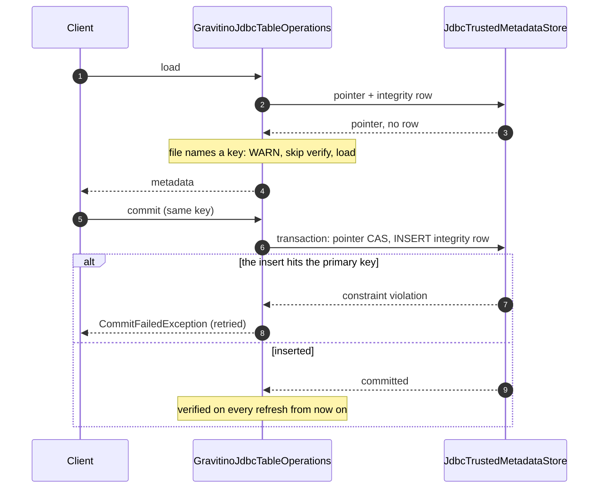

<!--
  Copyright 2026 Datastrato Inc.
-->

# Design: JDBC encrypted tables without an integrity row

Details [J6 of the JDBC SPIP](SPIP-jdbc-encryption-guarantees-and-atomic-integrity.md#j6-encrypted-tables-without-an-integrity-row-align-with-hive).
Decisions dated 2026-09-17; reviewed against the code.

Line references are to the implementation branch at review time and will drift. GJTO = `GravitinoJdbcTableOperations`, JCAT =
`JdbcCatalogWithMetadataLocationSupport`, JTMS = `JdbcTrustedMetadataStore`, IMI =
`IcebergMetadataIntegrity`, HCAT = `HiveCatalogWithMetadataLocationSupport`; HTO / HMSH are Iceberg
1.11.0 `HiveTableOperations` / `HMSTablePropertyHelper`.

## 1. Case and rule

**Case.** A JDBC catalog table whose metadata file names `encryption.key-id` but has no row in
`iceberg_metadata_integrity`. Gravitino's create and register write the pointer and the row
atomically, so the case arises from:

- writes outside an integrity-aware catalog: an engine's own `JdbcCatalog`, or this catalog while
  it ran in plain upstream mode (SPIP J4);
- the rename gaps in the SPIP errata (G1: upstream rename becomes delete plus insert; G3: the
  foreign key is missing, so the row stays under the old name).

**Rule: match Hive.**

| Operation             | Hive, no hash                                                                                                             | JDBC, no row                                                                     |
| --------------------- | ------------------------------------------------------------------------------------------------------------------------- | -------------------------------------------------------------------------------- |
| Load                  | Only when HMS holds a key: WARN, compare the HMS key id and DEK length with the file, load (HTO:208-209, 582-607)         | WARN, load. JDBC keeps no second copy of the key, so there is nothing to compare |
| Commit                | Key unchanged (HTO:320-328); the commit writes the hash (HMSH:112, 275-282)                                               | Key unchanged; the commit inserts the row in the same transaction                |
| Register-overwrite    | Refused: "Trusted metadata hash is missing" (HCAT:148 → IMI:116-118), or "not enrolled" when HMS holds no key (IMI:90-96) | Refused: "not enrolled"                                                          |
| Rename, drop          | Proceed                                                                                                                   | Proceed                                                                          |
| Enrollment paths      | Next commit                                                                                                               | First commit, or drop and register                                               |
| Batch enrollment tool | None                                                                                                                      | None                                                                             |

**Trust boundary.** The catalog database is trusted. Deleting or editing integrity rows, pointer
rows or table properties in it is out of scope; nothing guards those cases.

**Unverified window.** Until its first commit, the table's metadata file is not
hash-verified. A change to that file in object storage before the first commit is trusted by that
commit. Accepted as Hive parity; Hive additionally compares the HMS key id and DEK length on load.

**Policy.** Enforced at admission only (create, register, overwrite, staged publish), per SPIP
R3/R4. No policy or KMS check on load or on the enrolling commit. Register and overwrite admission
arrive with G-2, so until then drop and register enrolls without admission.

## 2. Behaviour by path

| Path                                                                                               | Today                                                                       | After                                                                                         |
| -------------------------------------------------------------------------------------------------- | --------------------------------------------------------------------------- | --------------------------------------------------------------------------------------------- |
| Load / refresh, metadata tables (`ns.t.snapshots`), credentials, scan planning, purge, async purge | Refused "not enrolled": each reaches `ops.current()` → `refreshAndVerify`   | WARN, load                                                                                    |
| Refresh of already-loaded ops at an unchanged pointer (e.g. commit retry)                          | Refused (GJTO:202-206)                                                      | Loads, no WARN                                                                                |
| Server cache hit                                                                                   | Never cached                                                                | Cached like any table; a hit does not warn (cache hits skip refresh for every table, SPIP R5) |
| Commit, same key                                                                                   | Refused                                                                     | Key guard, pointer CAS, row inserted in the same transaction; verified from then on           |
| Commit that changes, adds or removes the key                                                       | Refused                                                                     | Refused (`validateTableKey`, GJTO:341-347)                                                    |
| Register-overwrite                                                                                 | Refused at the refresh                                                      | Refused, now by `verify` in `repoint` (GJTO:288)                                              |
| Register of a new identifier                                                                       | Enrolls atomically                                                          | Unchanged                                                                                     |
| Rename, drop without purge                                                                         | Proceed: the pre-read gate only loads tables that have a row (JCAT:366-369) | Unchanged                                                                                     |
| Row present, its location differs from the pointer                                                 | Refused "pointer does not match" (GJTO:332-337)                             | Unchanged                                                                                     |
| Row present, file names no key                                                                     | Refused "trusted table key does not match" (IMI:98-101)                     | Unchanged                                                                                     |
| Plain upstream mode (no store)                                                                     | Unverified                                                                  | Unchanged (JCAT:146-147)                                                                      |
| Views                                                                                              | No integrity rows                                                           | Unchanged                                                                                     |

## 3. Code changes

About 30 lines in one class. `IcebergMetadataIntegrity.verify` stays strict, because Hive
register-overwrite shares it.

| Where                          | Change                                                                                                                                                                                                                                                                                                                                                                                                                                                 |
| ------------------------------ | ------------------------------------------------------------------------------------------------------------------------------------------------------------------------------------------------------------------------------------------------------------------------------------------------------------------------------------------------------------------------------------------------------------------------------------------------------ |
| `GJTO.refreshAndVerify`        | Predicate: the record has no integrity row **and** the file names a key. Use `!record.encrypted() && keyId(metadata) != null`, not "trusted is (null, null)", which a stale row also returns (JTMS:385-389). In the location-change loader (GJTO:197-201): WARN, skip `verify`. In the unchanged-pointer check (GJTO:205): skip `verify`, no log. Stale rows still throw earlier, in `trustedMetadata(record)` (GJTO:332-337).                         |
| `GJTO.repoint`                 | New parameter `enrollIfMissing`. `commitUpdate` passes `true`; `overwrite` passes `false`. When `true` and the record has no row: skip `verify` of the base, run `validateTableKey`, CAS the pointer, then `store.insert(transaction, id, newLocation, newTrusted)` (JTMS:164-177) instead of `store.update`. When `false`, `verify` at GJTO:288 refuses as today.                                                                                     |
| `GJTO.repoint`, insert failure | Catch the `SQLException` from `store.insert`. If `JdbcUtil.isConstraintViolation(e)`, throw `CommitFailedException(e, "Cannot commit table %s: integrity row was written by another process")`, which `CatalogHandlers.commit` retries; its refresh then verifies against that row. Cause: a concurrent drop and register of the same table. Two concurrent enrolling commits cannot collide: the loser's pointer CAS matches 0 rows first (GJTO:291). |
| Warning text                   | `Full metadata integrity check skipped because no integrity row was recorded for table {}.` Log only, no audit record.                                                                                                                                                                                                                                                                                                                                 |

**Warning frequency.** WARN each time a load reads a new metadata location, i.e. every
uncached load, as native Hive warns on every refresh. Refreshes of the same ops and server-cache
hits do not repeat it. No new state.

No change to dispatchers, the admission service, policy, audit vocabulary or Hive code.

## 4. Tests

Unit (H2 fixture) and contract (PostgreSQL + MySQL):

1. Load of an encrypted table without a row: loads, one WARN. `ops.refresh()` at the same
   location and a server-cache hit log nothing.
2. Commit on it with the same key: succeeds; the row exists and matches the new metadata; the next
   load verifies against it.
3. Commit that changes or removes the key on it: refused. Commit that adds a key to a plain table
   without a row: refused.
4. Register-overwrite on it: refused.
   `TestIntegrityJdbcTableOperations.testOverwriteRefusesTableWithoutIntegrityRow` plus a same-key
   target variant, so the assertion proves the `verify` refusal and not the key guard.
5. Row whose location differs from the pointer: still refused.
6. Purge, metadata-table load (`ns.t.snapshots`), rename and drop of a table without a row: succeed.
7. Insert hits the primary key: a store spy whose `load` reports no row while the row is already
   present, so `insert` fails → `CommitFailedException`, pointer unchanged.
8. WARN text matches §3 exactly.

Change `TestGravitinoJdbcTableOperations.testRefreshRevalidatesWhenPointerIsUnchanged` (:237,
assertion at :249-252) from "is not enrolled" to warn-and-load. Keep
`TestIcebergMetadataIntegrity.testVerifyRejectsUnenrolledEncryptedMetadata` (:86).

The cross-API missing-row load and first-commit enrollment journey is covered by
`IcebergEncryptionAtomicIntegrityIT.testEncryptedTableWithoutIntegrityRowLoadsAndFirstCommitWritesRow`.
Native Hive missing-hash fallback is covered by
`IcebergEncryptionHiveCatalogIT.testMissingHashFallsBackToKeyCompareWithWarning`.

## 5. Docs

| Document                                          | Change                                                                                           |
| ------------------------------------------------- | ------------------------------------------------------------------------------------------------ |
| SPIP #2062                                        | J6 per this design; R8 wording; Q6 risk row; Q4 commit diagram insert branch; ADR adjustment row |
| Parent SPIP `SPIP-governed-iceberg-encryption.md` | :369-370 "not enrolled automatically", :414 "incomplete trusted state also fails closed"         |
| Hive SPIP                                         | :644 "JDBC records without trusted state remain unsupported"                                     |
| ADR `design-trusted-metadata-integrity.md`        | Unamended; the change is recorded as an adjustment row in the JDBC SPIP errata                   |
| `docs/lakehouse-iceberg-catalog.md`               | :107-108 "not backfilled … remain unsupported"                                                   |
| J-5 design doc and operator page                  | Remove `enroll`; keep the schema `verify` command and check scripts                              |

## 6. Decisions (2026-09-17)

D1 no load-time policy check · D2/D4 commit enrolls, overwrite refuses (Hive) · D3 no policy
check on the enrolling commit · D5 WARN on every uncached load, like Hive; log only · D6 J-5 drops
`enroll`, keeps the schema `verify` command · D7 tampering with the catalog database is out of scope.
