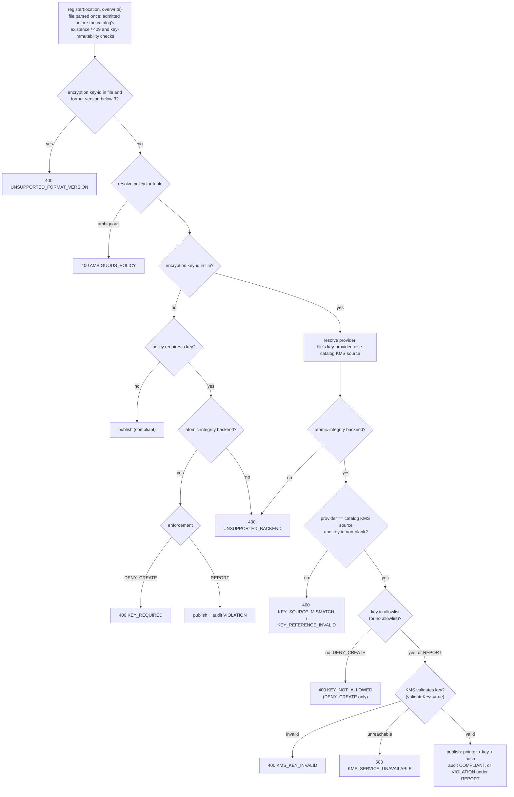

<!--
  Copyright 2026 Datastrato Inc.
-->

# Design: Encryption-policy admission of Iceberg table registration

| Field   | Value                                                                                                                                                                                 |
| ------- | ------------------------------------------------------------------------------------------------------------------------------------------------------------------------------------- |
| Status  | Accepted — 2026-09-16; implemented in [#2107](https://github.com/datastrato/gravitino-enterprise/pull/2107)                                                                           |
| Parent  | [SPIP: Hive Encryption Guarantees and Policy Enforcement](SPIP-hive-encryption-guarantees-and-policy-enforcement.md) (R3, R4, R8) · [ADR](../design-trusted-metadata-integrity.md) §1 |
| Related | [#1148](https://github.com/datastrato/gravitino-enterprise/issues/1148) · [#1887](https://github.com/datastrato/gravitino-enterprise/pull/1887)                                       |

## 1. Decision

**A table registration is admitted by the same encryption-policy evaluation as a table creation.**
The two operations differ only in their inputs:

|                               | Create                                                | Register                                                   |
| ----------------------------- | ----------------------------------------------------- | ---------------------------------------------------------- |
| Where the key comes from      | request properties, else catalog defaults             | the file's `encryption.key-id`                             |
| Who authored `metadata.json`  | Gravitino                                             | the client                                                 |
| May Gravitino change the key? | yes — the admitted key is forwarded into the metadata | no — the file is published as parsed; the key is immutable |
| Publication                   | one backend mutation: pointer + key + hash            | same                                                       |

The Gravitino catalog implementations (Hive, JDBC) perform **no policy checks**. Admission runs once,
above the catalog, on the governed Iceberg REST registration path, and the parsed metadata object
that passed admission is the object published (SPIP R8: "registration must publish the metadata
admitted"). The raw `Catalog.registerTable` API is not a governed entry point: Gravitino mediates
every pointer mutation of a governed catalog (ADR §1), and manual metastore repair is an operator
procedure rather than a code path.

## 2. Admission flow

Cheap checks precede the single KMS call; a request that admission will deny never reaches the KMS.
Admission runs before the catalog's existence check, so a `409` for a file with a key still costs
one KMS call when `validateKeys=true`.
This is the evaluation order already implemented by `EncryptionAdmissionService.admit` (format
version, then ambiguous policy, then backend capability) and `IcebergEncryptionPolicyEvaluator` (key
source, allowlist, KMS). The flow adds one rule, the file's own version
([SPIP: encryption format version](SPIP-encryption-format-version.md) R7): Iceberg parses and
registers a file that pairs a key with format-version 1 or 2 without complaint, so admission
refuses it, and does so first because the check depends on neither the policy nor the KMS.

The flow and the table below show `gravitino.encryption.validateKeys=true`, the optional
server-side key check. By default admission makes no KMS call: an allowed key goes straight to
publish, its audit record carries no KMS-validation field, rows 8 and 9 cannot occur (a key the KMS
rejects fails in the engine's KMS client when the table is read), and a `409` costs no KMS call.

## 3. Outcomes

| #   | File key                        | Policy        | Reason                            | `DENY_CREATE`    | `REPORT`                  |
| --- | ------------------------------- | ------------- | --------------------------------- | ---------------- | ------------------------- |
| 1   | none                            | none          | `NO_POLICY`                       | publish          | publish                   |
| 2   | none                            | not required  | `COMPLIANT`                       | publish          | publish                   |
| 3   | none                            | required      | `KEY_REQUIRED`¹                   | 400              | publish + audit VIOLATION |
| 4   | present                         | none          | `NO_POLICY` (KMS still validated) | publish if valid | same                      |
| 5   | present, in allowlist           | any           | `COMPLIANT`                       | publish          | publish                   |
| 6   | present, not in allowlist       | allowlist set | `KEY_NOT_ALLOWED`                 | 400              | publish + audit VIOLATION |
| 7   | present, provider ≠ catalog KMS | any           | `KEY_SOURCE_MISMATCH`             | 400              | 400                       |
| 8   | present, KMS rejects            | any           | `KMS_KEY_INVALID`                 | 400              | 400                       |
| 9   | present, KMS unreachable        | any           | `KMS_SERVICE_UNAVAILABLE`         | 503              | 503                       |
| 10  | blank                           | any           | `KEY_REFERENCE_INVALID`           | 400              | 400                       |
| 11  | present, file at version 1 or 2 | any           | `UNSUPPORTED_FORMAT_VERSION`      | 400              | 400                       |

`REPORT` may admit a **policy** violation (rows 3 and 6) but never invalid key input or a KMS
failure (SPIP R3). Rows 7–11 are hard failures in both modes.

¹ On a backend without atomic integrity, a required policy refuses the unencrypted file with
`400 UNSUPPORTED_BACKEND` under either enforcement, before `KEY_REQUIRED` is evaluated.

## 4. Error contract

Registration reuses the create error kinds so both operations are handled by one layer:

- Policy denial, key not allowed, invalid key reference, KMS-invalid key → `400 Bad Request`.
- KMS unreachable → `503 Service Unavailable`.
- Ambiguous policy → `400` with an `AMBIGUOUS_POLICY` audit record.
- A file that pairs a key with format-version 1 or 2 → `400 UNSUPPORTED_FORMAT_VERSION`, before
  the policy is resolved; the remedy is a file written at version 3 or later.
- Backend cannot publish pointer and hash atomically, and the file carries a key or the policy
  requires one (under either enforcement) → `400 UNSUPPORTED_BACKEND`.
- `MetadataIntegrityException` (`412`) is **not** used: none of these are integrity failures. It
  remains reserved for hash/key mismatch on load and on register-overwrite.

The shared wording is currently create-specific, and this is known. A registration refused for a
policy denial or an invalid key reference carries the create message ("Iceberg encryption denied
table creation: ..."); KMS failures use operation-neutral messages. A registration admitted with
an evaluated decision followed by an unclassified catalog failure is audited with reason
`TABLE_CREATE_FAILED`. A classified backend refusal takes precedence: typed integrity and
key-repoint refusals record `METADATA_INTEGRITY_FAILED`, while the recognized native Hive failure
shape records `NATIVE_LOAD_FAILURE`. The classified error type wins alongside its reason; the other
admission facts remain. A later change may make the create-specific wording operation-neutral.

## 5. Edge cases

1. **Key-id without key-provider in the file** — the common case; engines write only the id. The
   provider defaults to the catalog's KMS source. Without this default every encrypted
   registration would fail as `KEY_REFERENCE_INVALID`. Create applies the same default so both
   operations share one merge rule.
2. **Catalog has no KMS source, file has a key** → `KEY_REFERENCE_INVALID` for a key-id-only file
   (there is no source to complete the provider from); `KEY_SOURCE_MISMATCH` only when the file
   names a provider. A key that cannot be validated is not admitted.
3. **Overwrite of an existing table** — the key must equal the current key (immutability, checked
   by the catalog before publication); the unchanged key is still re-admitted because the
   allowlist may have changed since creation. One KMS call when `validateKeys=true`; none by
   default.
4. **Existing table, `overwrite=false`** → `409` from the catalog after admission; a file with a key
   spends one KMS call first when `validateKeys=true`, none by default.
5. **Policy requires a key, file unencrypted, `REPORT`** → the table is published and audited as a
   violation. This is the documented `REPORT` semantics, applied to registration as to creation.
   On a backend without atomic integrity it is refused instead (see the row 3 footnote).
6. **Registered encrypted file gains a trusted hash on publication** — the backend computes the
   hash from the file as given; there is no prior trusted state for a table that did not exist.
   Loads verify against that hash from then on.
7. **Retry after `503`** — idempotent: the retry publishes or returns `409`.
8. **Static or standalone Iceberg REST catalogs** — no governance layer; registration is not
   admitted by policy. Out of the governed scope by design (ADR §1).
9. **Direct `Catalog.registerTable` from server code** — not governed. Out of bounds for the same
   reason; a repair procedure, not a code path.

## 6. Consequences for the implementation stack

- The Hive and JDBC catalogs keep register-overwrite integrity safeguards (verify current state
  under lock; key immutability; no plain-to-encrypted overwrite) and nothing else.
- The governed REST registration path calls the shared admission with `operation = REGISTER`,
  the file's key, and the resolved provider, then publishes the parsed object through one
  `registerTable` entry point.
- Tests: one unit suite for the decision matrix above; one cross-API acceptance case per row 3,
  6, 7, 8 and 9; catalog tests assert single-read publication only.
