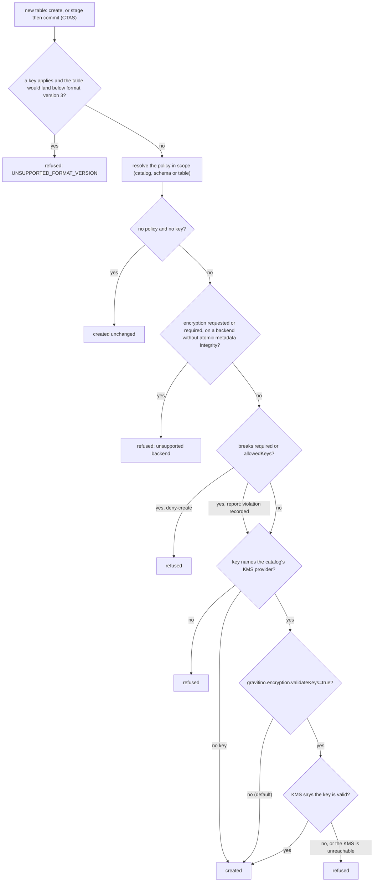

<!--
Copyright 2026 Datastrato Inc.
-->

---
title: Iceberg table encryption policy
slug: /iceberg-encryption-policy
---

## Overview

The built-in `system_iceberg_encryption` policy describes the encryption requirements for Iceberg
tables in scope. Scope follows Gravitino's normal policy association and inheritance
(catalog → schema → table), the same pattern as `system_iceberg_compaction`. The policy is
Iceberg-specific; it does not define a general encryption-policy language for other catalog
providers.

The standard policy fields own identity and lifecycle state. The typed `content` owns the required
encryption behavior. Associate the policy to a catalog, schema, or table after creation.

```json
{
  "name": "customer-data-encryption",
  "policyType": "system_iceberg_encryption",
  "comment": "Require an approved key for associated Iceberg tables",
  "enabled": true,
  "content": {
    "schemaVersion": 1,
    "required": true,
    "allowedKeys": [
      {
        "provider": "openbao-production",
        "keyId": "customer-pii-v1"
      }
    ],
    "enforcement": "deny-create"
  }
}
```

## Content fields

| Field           | Required    | Description |
|-----------------|-------------|-------------|
| `schemaVersion` | Yes         | Content schema version. Version 1 is the only supported value. |
| `required`      | No          | Whether an in-scope table must specify encryption. Defaults to `true`. |
| `allowedKeys`   | Conditional | Exact `{provider, keyId}` identities. At least one is required when `required` is `true`. |
| `enforcement`   | No          | `report` or `deny-create`, default `report`: what happens when a table breaks `required` or `allowedKeys`. `report` records it and proceeds; `deny-create` refuses. Policy-independent checks refuse either way (see [How a create is checked](#how-a-create-is-checked)). |

`provider` is the named KMS config handle (not the catalog plugin). `keyId` is the unmodified
provider-native key identifier. Protocol `api` is configuration on that provider, not part of the
policy identity.

`provider` must match `[A-Za-z0-9][A-Za-z0-9_-]*`. Duplicate `{provider, keyId}` entries are
rejected, as are null entries.

Policy content stores references only. It never stores KMS credentials or cryptographic key
material.

## How a create is checked

When a new Iceberg table is created, Gravitino checks it in this order and stops at the first
refusal. Every decision except a plain create with no policy and no key is written to the audit log
with a decision ID.



1. **Format version.** When a key applies, because the request names one or the catalog binds one,
   the table must land at format version `3` or later. Gravitino reads the version Iceberg would use
   and never raises it; a version below `3` is refused with `UNSUPPORTED_FORMAT_VERSION`. This runs
   before the policy, so `enforcement` does not change it. How the version is resolved on each path,
   and what a catalog that binds a key must declare, is in
   [Encryption and the Iceberg format version](../docs/lakehouse-iceberg-catalog.md#encryption-and-the-iceberg-format-version).
2. **Policy.** The policy in scope is resolved through the normal association chain. A table with no
   policy and no key is created exactly as requested. More than one policy in scope refuses the create
   (`AMBIGUOUS_POLICY`).
3. **Backend.** An encrypted table needs a backend with atomic metadata integrity: Hive, or JDBC on
   PostgreSQL or MySQL. On any other backend it is refused. The audit log records the refusal with
   the policy in scope, if any, and reason `OPERATION_FAILED`, but no compliance finding, because
   the policy rules never ran.
4. **Policy rules.** `required` and `allowedKeys` are checked. Under `deny-create` a violation
   refuses the create; under `report` it is recorded and the create goes on.
5. **Key.** A key must name the catalog's KMS provider. Its reference and provider are checked
   before `allowedKeys`. By default the server makes no KMS call, and a key the KMS cannot use fails
   in the engine's KMS client at first write. `gravitino.encryption.validateKeys=true` adds the
   optional server-side check: the KMS is called after `allowedKeys`, once per create; the stage of
   a `CREATE TABLE AS SELECT` makes no KMS call, and its commit makes the one. An invalid key, or an
   unreachable KMS, is then refused whatever `enforcement` says.

## Create a policy

```shell
curl -X POST \
  -H "Content-Type: application/json" \
  -d '{
    "name": "customer-data-encryption",
    "policyType": "system_iceberg_encryption",
    "comment": "Require an approved key for associated Iceberg tables",
    "enabled": true,
    "content": {
      "schemaVersion": 1,
      "required": true,
      "allowedKeys": [
        {"provider": "openbao-production", "keyId": "customer-pii-v1"}
      ],
      "enforcement": "deny-create"
    }
  }' \
  http://localhost:8090/api/metalakes/test/policies
```

Then associate it with a catalog, schema, or table using the normal policy association API
(`POST /api/metalakes/{metalake}/objects/{type}/{fullName}/policies`).

This document describes the policy API contract and how it applies when a table is created.
